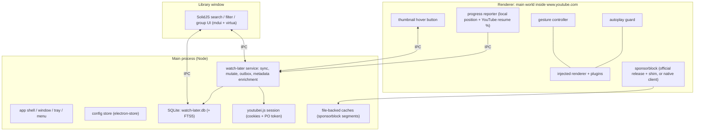

# PRD — YouTube desktop wrapper (working title: **Watchdeck**)

**Status:** draft for approval — **no implementation has started**.
**Revision 2** — incorporates erikenz's review comments (progress from YouTube's own resume indicator, Ultracite via `ultracite init`, debrand directive, naming criteria) and a read-only review of the `~/Projects/watchdeck` prototype.
**Author:** Delta agent, for erikenz.
**Source of truth for:** scope, verified research, architecture decisions, open questions.

> This document is the deliverable of the "research first, PRD, confirm, then build" step you asked for.
> Everything under *Verified findings* was measured or read directly (codebase, package registries, official docs, and a
> signed-out headless Chromium probe of youtube.com). Everything under *Open questions* needs your answer before I write code.

---

## 1. Summary

The workspace is a clone of [`pear-devs/pear-desktop`](https://github.com/pear-devs/pear-desktop) (itself a fork of
`th-ch/youtube-music`): an Electron app that loads `music.youtube.com` in a `BrowserWindow` and injects a plugin
framework that talks to the page's `#movie_player` API and the YouTube Music DOM.

What we are building instead: **a desktop wrapper for `www.youtube.com`** with a first-class Watch Later experience,
SponsorBlock, autoplay control and mouse gestures — with the pear-desktop plugin framework reused where it is good, and
the bulk of its 41 YouTube-Music plugins dropped.

The single most important research result: **the base plate is reusable, the plugin inventory is not.** The player API
surface (`#movie_player`, `videodatachange`, `getPlayerResponse()`) exists on `www.youtube.com` and behaves like it does
on YTM (verified below), but almost every plugin also depends on YTM-only DOM (`ytmusic-*`, `ytd-*`), YTM-only routes
(`FEmusic_*`), or YTM-only music metadata. So the plan is: keep the framework, delete the inventory, build ~8 new
plugins for YouTube.

---

## 2. Decision summary (TL;DR for review)

| # | Topic | Recommendation | Needs your answer? |
|---|-------|----------------|--------------------|
| D1 | Project name | **Watchdeck** (same domain, same criteria; alternates: Videck, Playdeck, Porthole) | **yes — Q1** |
| D2 | YouTube Music support | Drop it entirely; target `www.youtube.com` only | **yes — Q2** |
| D3 | Plugin inventory | Delete the YTM-only plugins; ship a documented plugin API + authoring guide in P0 so contributors can add their own | **yes — Q2** |
| D4 | Watch Later storage | SQLite via built-in `node:sqlite` (FTS5 verified on Node 24); DB owned by the main process | no (impl detail) |
| D5 | Watch Later sync | Main process, `youtubei.js` + session cookies (same pattern as the inherited downloader); mutations may go page-side via `window.ytcfg` if account handling requires it | no (impl detail, §4.2) |
| D6 | Watch Later UI | Dedicated "Library" window (SolidJS + mdui + `virtua`) for v1; in-page takeover of `/playlist?list=WL` later | **yes — Q3** |
| D7 | Hover "add to Watch Later" button | Injected into every thumbnail card (both `ytd-thumbnail` and the newer view-model cards); bottom-right over the duration-badge corner; 40×40 player-control look or the ~28 px overlay look — see Q4 | **yes — Q4** |
| D8 | SponsorBlock | Load the **official extension release at runtime** with a small compat shim (**revised** — see §5.1); native client only as fallback | **yes — Q7** |
| D9 | Disable autoplay | One-shot capturing `play` listener → `video.pause()`, armed on `yt-navigate-finish`/`popstate`; plus click YouTube's toggle to enforce off (`aria-checked` flip verified — `setAutonavState()` is a **no-op**) | no (verified) |
| D10b | Watch progress source | `max(local high-water mark, YouTube's own resume %)` — the resume % is available per item as `thumbnailOverlays[].thumbnailOverlayResumePlaybackRenderer.percentDurationWatched` (**revised** — see §4.3) | no (evidence-backed) |
| D10 | Gestures | Own pointer-state tracking + wheel/pointer movement; right-drag = volume, right-drag horizontal = seek, shift+right-drag = speed | **yes — Q6** |
| D11 | Lint/format | `pnpm dlx ultracite init --linter oxlint --pm pnpm --frameworks solid --type-aware` (command you specified), replacing `.oxlintrc.json`/`.oxfmtrc.json`; documented suppression list for type-aware rules that even the prototype had to disable | no (Q8 answered) |
| D12 | Versions | Exact pins everywhere (already the case) + `save-exact=true`; no pre-release pins — stable equivalents exist for all of them | no — resolved in §5.5 |
| D13 | Git history | Re-init in **your** checkout (`~Projects/youtube-client`), not in the Delta worktree (see §11) | **yes — Q10** |

---

## 3. Verified findings

### 3.1 Inherited architecture (what we keep)

| Layer | File(s) | Verdict |
|-------|---------|---------|
| Electron shell, window, tray, menu, i18n, auto-update | `src/index.ts`, `src/menu.ts`, `src/tray.ts` | keep, debrand, harden |
| Config store (electron-store + typed `get`/`set` + `watch`) | `src/config/*` | keep as-is |
| Plugin framework (backend / preload / renderer lifecycles, per-plugin config, hot enable/disable) | `src/loader/*`, `src/utils/index.ts`, `src/types/plugins.ts`, `vite-plugins/plugin-*.mts` | keep — this is the good part |
| Renderer injection into the page's **main world** | `src/preload.ts` + `src/index.ts` (`get-renderer-script`) | keep, but re-review (see §3.3) |
| Player/track providers | `src/providers/song-info*.ts`, `song-controls.ts`, `app-controls.ts` | rework for YouTube |
| 41 plugins under `src/plugins/` | — | delete inventory, keep ~0–3 |

Plugin mechanics worth knowing for the rewrite:

- A plugin is `src/plugins/<name>/index.ts` (or a single file) exporting `createPlugin({ name, description, config, menu, backend, preload, renderer, stylesheets })`.
- `vite-plugins/plugin-loader.mts` rewrites each plugin at build time: it strips contexts not needed for the current
  bundle and emits a `pluginStub` export. Contexts: `backend`, `preload`, `renderer`, `menu`.
- `vite-plugins/plugin-importer.mts` generates `virtual:plugins` (dynamic imports for main, static for preload/renderer,
  plus platform filtering).
- IPC `peard:*` and DOM ids `ytmd-*` are the inherited name prefixes; `LoggerPrefix = '[YTMusic]'`.

### 3.2 YouTube vs YouTube Music — measured, not guessed

Probed with headless Chromium against `www.youtube.com` (signed out, default 1280×633 viewport, player 880×495).

**Player API (present on `www.youtube.com`)**

| Something | Result |
|-----------|--------|
| `#movie_player.addEventListener('videodatachange', (name, data) => …)` | **fires**, names `dataloaded` then `dataupdated` — same contract the existing `song-info-front.ts` uses |
| `getPlayerResponse().videoDetails` | `title`, `lengthSeconds`, `keywords`, `shortDescription`, `channelId`, `author`, `viewCount`, `isLive`, `isLiveContent`, `thumbnail`, `isPrivate`, `allowRatings`, … |
| `getVideoData()`, `getProgressState()`, `getCurrentTime()`, `getDuration()`, `getVolume()`/`setVolume()`, `playVideo()`/`pauseVideo()`, `seekTo()` | all present |
| `setAutonavState()` | present but **did nothing** (`aria-checked` unchanged) → treat as unusable |
| `getAutonavState()` | **absent** |
| `#progress-bar` (YTM) | **absent** → time tracking must move to `<video>` `timeupdate` / `.ytp-progress-bar[role=slider][aria-valuenow]` |
| `#like-button-renderer` (YTM) | **absent** → like/dislike features that depend on it need rework (`like-button-view-model` / `#top-level-buttons-computed` instead) |

**DOM metrics relevant to the hover button** (this is the number you asked me to match)

| Element | Measurement |
|---------|-------------|
| `ytd-thumbnail` (search result, 500×281) | `position: relative` → safe host for an absolutely positioned button |
| `ytd-thumbnail-overlay-time-status-renderer` (duration badge) | **68×20 px**, inset **8 px** from right and bottom, font-size **10 px**; inner badge 64×20 |
| `.ytp-chrome-controls` | height **40 px** |
| `.ytp-mute-button` | **40×40** |
| `.ytp-subtitles-button` (CC) | **48×40** |
| `.ytp-settings-button` | **48×40** |
| `.ytp-button` default | `padding: 12px` |
| `.ytp-chrome-bottom` | 59 px tall in this window size |

So "the same size as YouTube's mute/CC button" = **40 px tall, 40–48 px wide** in the default window size; in big-mode
(fullscreen/very large player) YouTube scales these up. A hover-overlay button that visually matches the *thumbnail*
overlays would instead be ~28–32 px. Pick one — see Q4.

**Interactions verified**

- Clicking `.ytp-autonav-toggle-button` **flips `aria-checked` `true` → `false`** → this is the reliable way to force
  autoplay off (confirmed by DOM read-back, not by the API).
- Right-click while scrolling did *not* surface `WheelEvent.buttons === 2` through the CDP harness, so I could not confirm
  the browser-side bitmask. Consequence for design: **do not depend on `event.buttons`**; track right-button state from
  our own `mousedown`/`mouseup`/`pointercancel` listeners (see §5.6).

**Not verifiable here (you must validate on your machine):** the logged-in hover-preview controls on thumbnails, the
watch-later page layout, and YouTube's A/B-tested variants for the thumbnail overlay bar. YouTube's signed-out headless
surface differs from a real profile.

### 3.3 Inherited code: critical review (as requested)

| Sev | Finding | Why it matters |
|-----|---------|----------------|
| high | `electron-updater` points at `https://github.com/pear-devs/pear-desktop/releases/latest` (`src/index.ts:821`) and `options.autoUpdates` defaults to `true` | a released build of your app would offer to install pear-desktop. Must be disabled or repointed before the first build |
| high | Product identity is upstream everywhere: `package.json` `name`/`productName`/`desktopName`, `appId: com.github.th-ch.youtube-music`, `app.setName(...)`/WM_CLASS (Linux), Windows `AppUserModelId`, Start-Menu shortcut path, tray/desktop-entry names | broken shortcuts, two apps fighting over one identity, AppUserModelID collisions |
| high | `webPreferences.sandbox: false` in production (`src/index.ts:369-379`) | the preload has full Node access in a page that renders third-party content. Consider `sandbox: true` + moving privileged work to main, or an explicit risk note |
| med | `protocol.registerSchemesAsPrivileged` hijacks `http`/`https` globally and `removeContentSecurityPolicy()` strips CSP from every `https:` response while injecting `access-control-allow-origin: https://music.youtube.com` | needed for the injection architecture, but it is a wide attack surface; re-evaluate scope for youtube.com |
| med | `typescript: 7.0.1-rc`, `electron-vite: 6.0.0-beta.1`, `butterchurn@3.0.0-beta.5` | pre-release pins in a new project; the TS 7 RC also interacts with `oxlint-tsgolint` type-aware linting |
| med | `version: 3.12.0`, upstream `changelog.md`, `renovate.json`, `.github/workflows/winget-*.yml`, AUR/scoop/winget copy | inherited release identity; winget workflow would try to publish to *their* packages |
| med | Test coverage is one Playwright smoke test that asserts the URL is `music.youtube.com` (`tests/index.test.js`); no unit tests anywhere | nothing protects the sync/DB logic we are about to write |
| low | `src/pear-desktop.ts` is actually `declare module '*.css'`-style vite typings, not app code | misleading name; rename to `src/vite-env.d.ts` |
| low | `web/screenshot.png` (778 KB), `assets/icon.svg` + `assets/generated/**` icons, `patches/*` (5), Weblate i18n for ~40 locales | mostly upstream branding/music strings; needs pruning |
| low | "youtube" is written as `\u0079\u006f\u0075...` escapes in ~50 places | upstream de-trademarking artifact; unreadable, ungreppable. Use plain strings in the new project |
| low | `src/plugins/audio-compressor.ts` is an orphan single-file plugin; `tools/eslint-core-plugin.mjs` becomes obsolete with Ultracite | dead weight after the reset |

Nothing here changes the plan, but items 1–3 must land in phase 0, before any release build exists.

### 3.4 Prototype review — `~/Projects/watchdeck` (read-only reference)

You asked me to treat the prototype as reference only and keep pear-desktop as the primary influence. I read it without
editing anything; it is useful less as architecture (you are right that it is messy — e.g. a single 2 473-line preload
file) and more as a **source of verified YouTube facts** that confirm or correct my own findings:

| Taken from the prototype (as fact, to re-verify in a spike) | Correction/decision for this PRD |
|---|---|
| `thumbnailOverlays[].thumbnailOverlayResumePlaybackRenderer.percentDurationWatched` is YouTube's own per-item watch progress — read from item data, i.e. it arrives **for free with a playlist/browse response** | This answers your comment: YouTube's own progress indicator *can* be used, and better than I assumed. Adopted into `R1`/§4.3 as a second progress source |
| DOM equivalent: `.ytwThumbnailOverlayResumePlaybackRendererThumbnailOverlayResumePlaybackProgress`, `ytd-thumbnail-overlay-resume-playback-renderer #progress`, `[class*='ResumePlaybackProgress']` (read `style.width` as `%`, else measure widths) | Adopted as the DOM fallback for live pages; one selector module, not scattered strings |
| A separate "Watched" badge exists: `ytd-thumbnail-overlay-playback-status-renderer` / `ytw-thumbnail-overlay-playback-status-renderer` containing the word "watched" | Adopted as an additional watched signal (surface-dependent — treat as a hint, not truth) |
| `e.buttons === 2` on `wheel` **does** work in the real browser (their gestures plugin relies on it) | My earlier "do not trust `buttons`" was a CDP harness artifact. Design now uses `e.buttons === 2` with a tracked-state fallback (§5.6) |
| Setting `video.volume` and dispatching a `volumechange` event keeps YouTube's own volume UI in sync; HUD can be appended to `#movie_player` | Adopted |
| SPA navigation events `yt-navigate-finish` and `popstate` fire and are usable for arming/disarming behaviours | Adopted — simpler and more robust than `videodatachange` for autoplay control |
| `node:sqlite` `DatabaseSync` + FTS5 + triggers + `MATCH`/`rank` + LIKE fallback **inside an Electron main process** | Confirms the SQLite decision of §5.4 empirically (not just on host Node) |
| Ultracite 8.0.1 config shape produced by `init` for Oxlint, incl. the type-aware rules they had to turn off to get a green run | Adopted for the migration plan (§5.3) |
| Loading the **real** SponsorBlock release into Electron with a `chrome.storage.sync → storage.local` shim, MV3 service-worker notes, extension-dir-versioned caching | Revises §5.1: option B is viable; now the recommended primary with a spike |
| New-generation thumbnail hosts (`ytThumbnailViewModelHost`, `a.ytLockupViewModelContentImage`, `yt-thumbnail-view-model`) in addition to `ytd-thumbnail` | Adopted into the hover-button host list (R4) |

**Deliberately not taken** (evaluated and rejected): the in-page Watch Later UI on `playlist?list=WL` as the *primary* surface
(proven feasible, but it is what made the prototype monolithic and DOM-fragile — kept as phase 4, see Q3); DOM-scraping as the
*read path* for the list (replaced by resumable InnerTube `VLWL` paging, which also yields `setVideoId`); per-feature
ad-hoc settings UIs (replaced by plugin config + one Library window). Its own `db.ts` schema and thresholds heuristic were
read for reference only — the schema in R1 is mine (entry ids, sync runs, outbox, provenance columns) because the prototype
did not need re-add safety or resumable sync.

---

## 4. Research: Watch Later (the core feature)

### 4.1 Why a local database is the right answer

- The Watch Later list is the internal playlist `WL` (`https://www.youtube.com/playlist?list=WL`).
- The **official YouTube Data API cannot read `WL` at all** — Google blocked third-party access to it in 2016 (only
  `HL`, the history list, was ever exposed, and it is broken too). Any implementation must use **InnerTube**, the private
  API the web client itself uses, authenticated with your own session cookies.
- InnerTube returns playlist pages of about **100 items** with `continuation` tokens (`youtubei.js`'s `getPlaylist()`
  returns the first 100 and requires `has_continuation` + `getContinuation()` loops to get the rest). A 2 000-item list is
  ~20 round trips — fine for a background sync, unusable as a UI.
- There is **no search endpoint for playlists** and no per-item "watched" flag in the playlist response, so search,
  filtering and grouping must be local. That is exactly what you asked for.

### 4.2 Endpoints and payloads (verified in the wild, incl. YouTube's own menu data)

```jsonc
// read a page (first page: no continuation; later pages: continuation token from the previous response)
POST https://www.youtube.com/youtubei/v1/browse
{ "context": { "client": { "clientName": "WEB", "clientVersion": "…" } }, "browseId": "VLWL" }

// add to Watch Later — this is the payload YouTube's own "Save to Watch Later" menu item sends
POST https://www.youtube.com/youtubei/v1/browse/edit_playlist
{ "playlistId": "WL", "actions": [ { "action": "ACTION_ADD_VIDEO", "addedVideoId": "<videoId>" } ] }

// remove from Watch Later — removal is keyed by the per-entry id, not the video id
{ "playlistId": "WL",
  "actions": [ { "action": "ACTION_REMOVE_VIDEO", "setVideoId": "<setVideoId from the list response>" } ] }
```

Consequences for the design:

1. `setVideoId` must be stored per entry (it changes when a video is re-added) → part of the sync, not an afterthought.
2. Every mutation needs the page/response context; the same session that is logged in must perform the call.
3. `youtubei.js` (already a dependency, `17.2.0`; latest is `18.1.0`) exposes `Playlist` (`items`, `has_continuation`,
   `getContinuation()`, `info.total_items`) and a `PlaylistEditRequest` type for `/browse/edit_playlist`, plus cookie and
   BotGuard/PO-token support — the inherited `downloader` plugin already implements cookie extraction
   (`session.cookies.get`) + PO-token generation (`bgutils-js`) in the main process. We reuse that pattern.
4. Caveat: multi-account sessions need `X-Goog-AuthUser` / `SESSION_INDEX`; `youtubei.js`'s `account_index` is known to be
   unreliable (upstream issue #735). Design assumption: **the active (first) account of the browser session** — see Q12.

### 4.3 Where the watched/continue-watching numbers come from (revised)

You are right that YouTube's own resume indicator is usable, and it is better than I first claimed. There are **three**
sources, and the design uses all of them:

1. **YouTube's own resume percentage, per item — free with the sync.** Playlist/browse items can carry
   `thumbnailOverlays[].thumbnailOverlayResumePlaybackRenderer.percentDurationWatched` (integer percent). Because a full
   `VLWL` sync already walks every item, the sync can store this without a single extra request. This is exactly the
   "watch progress bar indicator" you meant, and it is the source that also covers videos you watched *before*
   installing the app — the gap I originally called out as a limitation.
2. **The same value in the DOM**, for pages we are already looking at:
   `ytd-thumbnail-overlay-resume-playback-renderer #progress` (and the newer
   `ytwThumbnailOverlayResumePlaybackRendererThumbnailOverlayResumePlaybackProgress` /
   `[class*='ResumePlaybackProgress']`), where the width is either an inline `%` or has to be measured against its parent.
   Useful as a cross-check and for videos that are added to WL mid-session.
3. **Local high-water mark** from our own tracking (`video.currentTime` / `getProgressState()` while a video plays),
   which is the only source that knows about precision, per-session detail, and re-watches.

**Classification rule (revised):** `effective_ratio = max(local_max_position / duration, yt_percent / 100)`, where
`yt_percent` is refreshed on every sync. Everything else in R1 (thresholds, buckets, query-time re-classification) stays as
specified — the thresholds are applied to `effective_ratio`, so "configure a min %/minutes" still works exactly as you asked.

Known limits, to be honest about and to surface in the UI:

- YouTube only publishes a resume percentage for **partially watched** videos. A finished video has no resume bar, and a
  never-started video has none either — so **absence is ambiguous** and must never be read as "unwatched".
- The percentage is coarse (whole numbers) and is the *furthest* position YouTube recorded, not accumulated watch time; a
  throwaway scrub to 95 % counts as 95 %. The optional "Watched" badge
  (`ytd-thumbnail-overlay-playback-status-renderer`, text contains "watched") is a second signal for fully-watched videos
  where YouTube decides to render it.
- It is per Google account, so it arrives with the session that the sync uses (see §4.2 note on `X-Goog-AuthUser`).
- Provenance is stored per row (`progress_source`: `local`, `youtube`, or `both`), so the Library UI can show where a
  number came from and a future setting can prefer one source over the other.

---

## 5. Research: the other requirements

### 5.1 SponsorBlock — revised after the prototype review

The prototype proves something my first pass got wrong: **the official SponsorBlock release does load and work inside
Electron**, with a small compatibility shim. Concretely, from its `sponsorblock/extension.ts` + `backend.ts` (read-only):

- the release (`ChromeExtension.zip` from GitHub releases) is downloaded at runtime into `userData` and loaded with
  `session.extensions.loadExtension(dir, { allowFileAccess: true })`;
- Chromium runs the MV3 **service worker** background well enough, but `window` is absent there, which breaks maze-utils'
  config reads;
- Electron exposes `chrome.storage.local` but **no usable `chrome.storage.sync`** — SponsorBlock's config layer calls
  `sync.get(null, cb)` and waits on `sync.onChanged` for `Config.isReady()`, so a missing `sync` both throws and leaves the
  config permanently unready. Aliasing `sync` onto `storage.local` fixes it;
- Electron derives an unpacked extension's id from its **path**, and Chromium caches the service-worker script by that id,
  so the shim version must be part of the directory name to invalidate the cache.

Both options, for the record:

| | Option A — load the official extension (recommended, with a spike) | Option B — native client against the public API (fallback) |
|---|---|---|
| Feature coverage | full: skip/mute/full/poi, category UI, segment highlight on the progress bar, votes, auto-updates | only what we implement (skip/mute/full/poi + categories + cache), forever behind upstream |
| Maintenance | upstream maintains behaviour; we maintain a ~50-line shim + the update/download path | we own everything, including every YouTube player change |
| Licensing | GPL-3.0 code is **not bundled**: the user's machine fetches the official release at runtime, so SB stays a separate program (an about-dialog note + download consent is still good practice) | no SB code at all |
| Electron gaps | `chrome.action` popup and `options_ui` are unreachable → SB's standalone settings window/popup is not available; the in-player SB UI (content script) is what works | we build our own settings UI |
| Risk | shim breaks on an upstream release; download needs network on first use; unpacked-extension loading is not a documented Electron feature | more of our own code, less feature parity |

**Plan:** P3 starts with a bounded spike (≤1 h): load the current release with the shim, then verify (a) the background SW
runs, (b) the SponsorBlock button/menu appears in the player and skipping works, (c) config survives a restart,
(d) the extension can be disabled/enabled from our menu, (e) cold start with no network still gives a usable app.
If (a)–(e) pass → Option A ships as the default with an explicit "download SponsorBlock from its official release"
consent step, and Option B stays untouched. If they fail → Option B, implemented as specified in revision 1
(`{api}/api/skipSegments/{sha256HashPrefix[4]}`, `actionType` handling, per-category toggles incl. `music_offtopic`,
segment cache in SQLite, optional `userID` for later voting).

### 5.2 Disable autoplay

Two distinct behaviours, both configurable (the inherited plugin only does the second):

1. **Enforce autoplay = off**: click `.ytp-autonav-toggle-button` until `aria-checked === 'false'` (verified working).
   `#movie_player.setAutonavState()` must not be used — it is a silent no-op (verified).
2. **Stop auto-advance**: arm a one-shot capturing `play` listener on `document`, and pause on the first play that follows
   a navigation — armed on `yt-navigate-finish` and `popstate`, disarmed on timeout so a deliberate click always works.
   The prototype uses exactly this (and it is more robust than my earlier `videodatachange`+`pauseVideo` proposal, because
   it catches every play path, including playlist auto-advance).

The inherited plugin's config shape (`enabled`, `applyOnce`) is fine; the prototype's `blockOnLoad` / `blockOnNavigation`
split is a better default set and I will adopt it (`applyOnce` kept).

### 5.3 Ultracite + Oxlint (setup command fixed)

Setup is exactly the documented flow you asked for, run once in the repo root:

```bash
pnpm dlx ultracite init --linter oxlint --pm pnpm --frameworks solid --type-aware
```

What that produces (verified against the prototype's committed output, which was generated by the same command):

- `oxlint.config.ts` — `defineConfig({ extends: [core, solid, …, jsPlugins], options: { typeAware: true }, rules: { … } })`,
  importing `ultracite/oxlint/core`, `ultracite/oxlint/solid`, `ultracite/oxlint/vitest`, `ultracite/oxlint/anti-slop` and
  `ultracite/oxlint/js-plugins`;
- `oxfmt.config.ts` — `{ ...ultracite }` from `ultracite/oxfmt` plus our ignore patterns;
- `AGENTS.md` — Ultracite's code standards (our repo has none today; taking it is a bonus);
- deletion of `.oxlintrc.json` / `.oxfmtrc.json`, and the **installed** versions the preset was verified with:
  `ultracite 8.0.1`, `oxlint 1.88.0`, `oxfmt 0.73.0`, `oxlint-tsgolint 7.0.2004`, `typescript 7.0.2` (the prototype's set,
  which lints cleanly together — the repo's current `oxlint 1.71.0` / `oxfmt 0.56.0` / `oxlint-tsgolint 0.23.0` satisfy
  neither);
- commands become `ultracite check` / `ultracite fix` (`--unsafe`, `--type-check` available); `package.json` `lint` /
  `format` / `format:check` / `check` get rewired, and CI runs `ultracite check` + `typecheck`.

**Migration reality check (from the prototype, not theory).** Even in a greenfield project, `--type-aware` flags enough
that these rules had to be turned off to get a green run: `typescript/await-thenable`, `no-confusing-void-expression`,
`no-floating-promises`, `no-misused-promises`, `no-unnecessary-type-arguments`, `no-unsafe-argument`,
`no-unsafe-assignment`, `prefer-nullish-coalescing`, `prefer-readonly`, `prefer-regexp-exec`, `promise-function-async`,
`return-await`, `strict-boolean-expressions`, `strict-void-return`. On a ~40 k-line inherited codebase the same list (plus
`complexity`, `import/no-cycle`, `unicorn/*`) will fire far more often.

**Therefore: fix-first, then a documented suppression list — not a full-repo rewrite.** Order: (1) delete the plugin
inventory and debrand *first* (§R5, §R8), (2) run `ultracite fix` on what remains, (3) triage the leftovers: fix the cheap
ones, and for the type-aware/strictness rules above, commit an explicit override block with a one-line reason each (the
prototype's config shows the pattern and its comment is the right tone). No blanket `ignorePatterns` — those hide new code
too. That is my answer to Q8(a)/(b); if you want the opposite (fully clean baseline, large one-off diff), say so.

Also set `.npmrc` `save-exact=true` so "no carets" holds for future installs, and keep the inherited `minimumReleaseAge`
guard in `pnpm-workspace.yaml`.

### 5.4 SQLite in Electron — options compared

| Option | Verdict |
|--------|---------|
| `node:sqlite` (built-in, Node ≥ 22.5, no flag since Node 23.4) | **Recommended and empirically confirmed.** Verified on this machine (Node 24.21: `DatabaseSync`, FTS5 virtual tables, bm25, SQLite 3.53.4) **and** independently confirmed inside an Electron main process by the prototype (`DatabaseSync` + FTS5 + triggers + `MATCH`/`rank` + `LIKE` fallback in `src/db.ts`). Wrap it in a thin `Db` interface because Node still marks it experimental. |
| `better-sqlite3` | Fallback. Always ships FTS5, but is a V8-native addon: needs `electron-rebuild`, an entry in `pnpm-workspace.yaml` `allowBuilds`, and has a *different ABI from host Node* (so scripts/tests cannot share the binary). |
| `sql.js` / WASM | Rejected: whole-DB-in-memory, awkward persistence for a 10 k-row corpus. |

Because both real options are synchronous APIs with near-identical shapes (`prepare/get/all/run`), the DB layer should be
written against a tiny adapter interface so swapping is a 30-line change.

### 5.5 Package-version policy

- "Latest possible, no carets": already true for the inherited manifest (all exact). Add `.npmrc: save-exact=true`,
  keep `engineStrict`, and rewrite `renovate.json` for the new repo (it currently carries pear-desktop's config).
- Tension resolved: the pre-release pins can go, because stable equivalents exist. The prototype runs
  `typescript 7.0.2` (stable), `electron-vite 6.0.0` (stable), `ultracite 8.0.1` + `oxlint 1.88.0` + `oxfmt 0.73.0` +
  `oxlint-tsgolint 7.0.2004` and `electron 44.7.2`, `vite 8.3.4`, `mdui 2.1.5`, `solid-js 1.9.17`, `zod 4.6.7`,
  `vitest 5.0.5`. Treat that as a *starting snapshot*, not gospel: re-resolve each with `pnpm outdated` /
  `pnpm update --latest` at implementation time and re-verify `ultracite check` after each bump. The inherited RC/beta pins
  (`typescript 7.0.1-rc`, `electron-vite 6.0.0-beta.1`) go away; `butterchurn*` becomes moot if the visualizer plugin is
  deleted per R5.
- Dependencies that can go once the YTM plugin inventory is deleted (examples): `butterchurn*`, `vudio`, `@foobar404/wave`,
  `kuroshiro*`/`kuromoji`/`hanja`/`pinyin-pro`/`@indic-transliteration/sanscript`/`chinese-conv`/`es-hangul`
  (lyrics-language tooling), `peerjs` (music-together), `howler`, `@jellybrick/mpris-service`, `@xhayper/discord-rpc`
  (keep only if the corresponding plugin survives), `youtubei.js` (**keep** — needed for sync + downloads).

### 5.6 Gestures: what is actually implementable

- Wheel/pointer events reach the page; the inherited `precise-volume` plugin proves wheel capture works in this container
  (on YTM), and the prototype's gestures plugin proves it on YouTube. Surface for gestures: `#movie_player`,
  `.html5-video-player`, `#player`, `video` (+ `document.fullscreenElement` ⇒ always armed).
- **Right-button detection works in practice**: the prototype gates its wheel handler on `e.buttons === 2` and it works on
  YouTube. My CDP probe could not simulate that bitmask — that was a harness limitation, not a browser one. Design:
  primary check `e.buttons === 2`, plus our own tracked button state as a fallback (covers exotic platforms/pointer kinds),
  `{ passive: false }` on the wheel listener, and `contextmenu` suppressed with a capturing listener only after a
  gesture actually fired (so a plain right-click still opens YouTube's menu).
- Volume should be applied as `video.volume = x` + `new Event('volumechange')` dispatch, so YouTube's own volume UI and
  its `mute` state stay in sync (verified approach in the prototype); the HUD is appended to `#movie_player`.
- Reset state on `blur` / `pointercancel` / navigation so a gesture can never get stuck.
- Sensible v1 set: right+wheel → volume (the gesture you named), right-drag vertical → volume, right-drag horizontal →
  seek, shift+right-drag → playback speed. Everything else (frame step, mute, zoom, nothing) lives in the same mapping
  table, config-only.
- Keep YouTube's own interactions intact: double-click fullscreen, `k`/`j`/`l`, click-to-pause, and the native context
  menu outside the player area.

---

## 6. Proposed architecture



Data flow for the quick-add button (the round trip that must feel instant):

1. Renderer keeps an in-memory `Set<videoId>` of Watch Later membership, hydrated from main on startup and kept in sync.
2. Click → optimistic UI (spinner→filled icon) → `ipc.invoke('wl:add' | 'wl:remove', videoId)`.
3. Main performs the InnerTube mutation, updates `wl_entry` + `video`, returns the new authoritative state.
4. Renderer updates the set (and every other visible thumbnail reflects it), or reverts + shows a toast on failure.
5. If offline/unauthorized the mutation goes to an `outbox` table and is replayed on the next sync.

---

## 7. Requirements → design

### R1 — Enhanced Watch Later

**Database schema (SQLite, main process, `userData/watch-later.db`)**

```sql
CREATE TABLE video (
  video_id            TEXT PRIMARY KEY,
  title               TEXT NOT NULL,
  channel_id          TEXT,
  channel_title       TEXT,
  description         TEXT,
  duration_seconds    INTEGER,
  published_at        TEXT,      -- ISO-8601, from microformat/dateText when available
  thumbnail_url       TEXT,
  tags_json           TEXT,      -- videoDetails.keywords
  is_live             INTEGER NOT NULL DEFAULT 0,
  availability        TEXT NOT NULL DEFAULT 'unknown', -- ok | private | deleted | region_blocked | needs_auth
  details_synced_at   TEXT,
  raw_json            TEXT       -- full player response snapshot for future fields
);

CREATE TABLE wl_entry (          -- membership + position inside WL
  video_id       TEXT PRIMARY KEY REFERENCES video(video_id),
  set_video_id   TEXT,           -- required by ACTION_REMOVE_VIDEO
  position       INTEGER,        -- order in the YouTube list
  first_seen_at  TEXT NOT NULL,
  last_seen_at   TEXT NOT NULL,
  removed_at     TEXT            -- soft delete when it disappears from WL
);

CREATE TABLE progress (
  video_id               TEXT PRIMARY KEY REFERENCES video(video_id),
  max_position_seconds   REAL NOT NULL DEFAULT 0,   -- high-water mark (local)
  duration_seconds       REAL,                      -- observed in the player
  total_watched_seconds  REAL NOT NULL DEFAULT 0,
  last_position_seconds  REAL,
  last_watched_at        TEXT,
  play_count             INTEGER NOT NULL DEFAULT 0,
  yt_percent_watched     REAL,                      -- YouTube's own resume % (thumbnailOverlayResumePlaybackRenderer)
  yt_watched_badge       INTEGER NOT NULL DEFAULT 0, -- "Watched" badge seen on a thumbnail
  yt_percent_seen_at     TEXT,                      -- freshness of the value above
  progress_source        TEXT NOT NULL DEFAULT 'none' -- none | local | youtube | both
);

CREATE TABLE sync_run (id INTEGER PRIMARY KEY, started_at TEXT, finished_at TEXT,
                       pages INTEGER, items INTEGER, status TEXT, error TEXT);
CREATE TABLE outbox (id INTEGER PRIMARY KEY, kind TEXT, video_id TEXT,
                     created_at TEXT, attempts INTEGER DEFAULT 0, error TEXT);
CREATE TABLE sb_segment (video_id TEXT, category TEXT, start_s REAL, end_s REAL,
                         action_type TEXT, fetched_at TEXT, PRIMARY KEY (video_id, category, start_s));

CREATE TABLE video_fts USING fts5(video_id UNINDEXED, title, description, channel_title, tags);
-- kept current by triggers on video/insert/update/delete; queries via MATCH + bm25()
CREATE INDEX idx_wl_position ON wl_entry(removed_at, position);
CREATE INDEX idx_video_channel ON video(channel_id);
```

**Sync algorithm**

1. Ensure a logged-in session (read `session.cookies.get({url:'https://www.youtube.com'})`; if `SID`/`SAPISID` missing →
   state `needs_auth`, surface in UI, stop).
2. Page `VLWL`, 100 items/page, persisting the continuation token after each page (resumable), with:
   - rate limiting (default 1 request/second, exponential backoff on 429/5xx),
   - cancellation when the window/plugin is disabled,
   - a `sync_run` row for observability.
3. Upsert `video` stubs (id/title/thumbnail/duration/channel from the playlist item) and `wl_entry` rows
   (`set_video_id` from the response, `position`, `first_seen_at` preserved, `last_seen_at` refreshed,
   `removed_at` set for entries that no longer appear), and **capture YouTube's own watch progress from the same item** when
   present (`thumbnailOverlays[].thumbnailOverlayResumePlaybackRenderer.percentDurationWatched` → `progress.yt_percent_watched`).
   This costs no extra request — it is why a fresh install can already classify videos you watched elsewhere (see §4.3).
4. Queue metadata enrichment for rows with `details_synced_at IS NULL` or older than N days: fetch
   `videoDetails` (description, keywords, channelId, isLive) with bounded concurrency (2–3) and store in one transaction
   per batch.
5. Emit a progress event per page so the UI can show "312/1487 synced" (the sync of a big list must be visible, not a
   silent 20-request burst).

**Triggers:** app start (if enabled and logged in), manual (menu + UI button), interval (default 6 h, configurable,
0 = manual only), after any in-app add/remove (single-item update, no full re-sync), and on `wl:resync` IPC.

**Classification (configurable, the feature you asked for)**

Let `ratio = max(max_position_seconds / duration, yt_percent_watched / 100)`, and `seconds = max(max_position_seconds,
(yt_percent_watched / 100) * duration)`. Thresholds are applied to those two derived numbers, so both sources feed one rule.

| Bucket | Rule (all thresholds configurable) | Default |
|--------|-----------------------------------|---------|
| **Watched** | `seconds >= watched.minutes*60` **or** `ratio >= watched.percent/100` **or** `yt_watched_badge = 1` | minutes 0 (disabled), percent **90** |
| **Continue watching** | not *watched* **and** (`seconds >= inProgress.minMinutes*60` **or** `ratio >= inProgress.minPercent/100`) **and** `ratio < inProgress.maxPercent/100` | minMinutes **2**, minPercent **5**, maxPercent **90** |
| **Unwatched** | everything else, including rows with **no** progress record at all | — |

Notes: thresholds are stored as `{ minutes?: number; percent?: number }` where either field alone can carry the rule
(percent disabled if `null`); *watched* wins over *continue watching*; live streams (`is_live = 1`) are excluded from both
buckets unless `lengthSeconds > 0`; **absence of YouTube's resume bar is never read as "unwatched"** (it means "no resume
position published"); local and YouTube values are stored separately so the UI can show the provenance and a future setting
can prefer one. Values are computed at query time, so changing a threshold re-filters the list instantly without re-syncing.

**Search & grouping**

- Default search: FTS5 over `title`, `description`, `channel_title`, `tags` with prefix queries for incremental typing
  (`"lofi hip*"`), ranked by bm25; fall back to `LIKE` when FTS5 is unavailable (probe at startup).
- Filters: bucket (unwatched / continue watching / watched), channel, tag, duration range, saved-date range, `is_live`,
  availability. Combinable, and saved as named presets optionally (phase 2).
- Grouping: by channel (default when grouping is on) — collapsible groups, count per channel, sort by name, recent activity or video count;
  grouping applies after filtering, so "continue watching, grouped by channel" is one query.
- Sorting: recently saved (WL position), channel, duration, last watched, watch progress.

**Acceptance criteria**

- A 1 000+ item Watch Later list syncs fully, resumably, with a visible progress indicator and no UI freeze.
- Killing the app mid-sync and restarting continues from the last persisted page rather than page 1.
- Adding/removing from YouTube's own UI is reflected after a sync; adding/removing from our UI is reflected on YouTube
  (verified by reloading `playlist?list=WL` in the app).
- Search returns results within ~50 ms for a 1 000-row corpus; filters + grouping are instant.
- Changing the "watched" percentage re-classifies the list without re-syncing.
- Duplicate `addedVideoId` responses do not create duplicate rows; re-adding a video refreshes `set_video_id`.
- A list whose videos were watched on another device (YouTube resume % present, no local history) is classified as
  continue-watching/watched accordingly, and the row shows which source the number came from.

### R2 — SponsorBlock. See §5.1 for the revised approach: P3 opens with a bounded spike that tries to load the official
extension release with a `chrome.storage.sync → storage.local` shim; on success that is the shipping path (full feature
coverage, upstream-maintained), otherwise the native client is implemented. Acceptance for either path: skipping works and
respects `actionType` (`skip` vs `mute` vs `full` vs `poi`), per-category settings are controllable from our menu, segment
data is not re-fetched on every view (extension cache, or our SQLite cache in the native path), and enabling/disabling
the plugin cleanly loads/unloads the extension (or unregisters our listeners) without a restart.

### R3 — Disable autoplay: see §5.2. Acceptance: (a) opening any watch URL leaves autoplay off, and it stays off after a
  restart; (b) with "stop auto-advance" on, an auto-loaded video is paused within ~1 s; (c) manually choosing a video (click
  or keyboard) is never paused; (d) `applyOnce` limits the block to once per session when set.

### R4 — Quick add to Watch Later (hover button)

**Hosts:** every thumbnail card — classic `ytd-thumbnail` (`ytd-rich-item-renderer` on home/subscriptions,
`ytd-video-renderer` in search, `ytd-grid-video-renderer` on channels, `ytd-compact-video-renderer` in the watch-page
sidebar, `ytd-playlist-video-renderer` in playlists) **and** the newer view-model cards (`yt-thumbnail-view-model`,
`a.ytLockupViewModelContentImage`, `ytThumbnailViewModelHost`) that YouTube already serves on some surfaces — the
prototype needed both generations, so plan for both. Shorts (`ytd-reel-item-renderer`) excluded in v1. Implementation: one
`MutationObserver` + a light custom element (`<wl-save-button>`) reused for all hosts, so a host's re-render does not
duplicate buttons.

**Placement (measured):** bottom-right of the thumbnail, **8 px inset** (same as the duration badge). The duration badge
occupies exactly that spot (68×20 px), which is why the interaction needs a decision (Q4):
(a) overlay and hide the badge while the button is shown, (b) keep the badge and shift it left by the button width,
(c) draw the button on top of the badge semi-transparently. My recommendation: **(b)** — the badge stays readable,
which matches YouTube's own habit of keeping the duration visible and is the least surprising in a list of thumbnails.
One extra wrinkle worth knowing up front: when YouTube starts its inline hover **preview**, the preview surface replaces
the thumbnail, so the button has to follow it (the prototype re-offsets the button by the delta between the preview rect
and the thumbnail rect) — that logic belongs in the shared button module, not in each host.

**Size (measured):** 40×40 hit area with a 24 px icon inside, translucent dark circle, hover states matching YouTube's
own `rgba(0,0,0,.6)`-style overlays. If you prefer the *thumbnail-overlay* look instead of the *player-control* look,
28×28 is the alternative (Q4).

**States:** not-saved (clock-plus) / saved (filled clock or check) / pending (spinner) / error (retry). Tooltip and
`aria-label` localized (`Save to Watch Later` / `Remove from Watch Later`), keyboard focusable, click never navigates
(`preventDefault` + `stopPropagation` on both `mousedown` and `click`).

**Acceptance:** the button appears on hover for all listed hosts (verified by screenshot on home/search/channel/sidebar/
watch-page playlist), the icon reflects real WL membership (including changes made on youtube.com), clicking adds/removes
within ≈1 s with optimistic feedback, and holding a click on it never opens the video or the inline preview.

### R5 — Plugins: what happens to the 41 inherited ones

Rule of thumb: **keep the framework, delete the inventory**, then re-add deliberately. Measured YTM-coupling per plugin
(`ytmusic-*` selector count) supports this: `in-app-menu` 39, `album-color-theme` 33, `picture-in-picture` 30,
`synced-lyrics` 18, `downloader` 16, `music-together` 16, `unobtrusive-player` 13, `video-toggle` 11, `album-actions` 10 —
all music-app UI; while `visualizer`, `sponsorblock`, `skip-silences`, `taskbar-mediacontrol`, `touchbar`, `tuna-obs`,
`equalizer` and `crossfade` contain **zero** `ytmusic-*` selectors.

| Action | Plugins |
|--------|---------|
| **Delete outright** (music-app semantics, no YouTube meaning) | `album-actions`, `album-color-theme`, `synced-lyrics`, `music-together`, `skip-disliked-songs`, `quality-changer`, `video-toggle`, `blur-nav-bar`, `transparent-player` (music-only look), `unobtrusive-player`, `tuna-obs`, `lumiastream`, `amuse`, `clock`, `captions-selector` (music captions UI) |
| **Rebuild for YouTube** (feature is wanted, DOM is YTM-bound) | `in-app-menu`, `picture-in-picture`, `precise-volume` + gestures, `downloader`, `notifications`, `playback-speed`, `equalizer`, `ambient-mode` (maybe) |
| **Port almost verbatim** | `disable-autoplay`, `sponsorblock` (as reworked plugin), `shortcuts`, `api-server`, `do-not-track` (adblocking caveat: YouTube serves most ads from the same origin, effectiveness is limited), `taskbar-mediacontrol`, `touchbar`, `discord`, `scrobbler` (only if music scrobbling still matters), `visualizer`, `skip-silences`, `performance-improvement`, `auth-proxy-adapter`, `custom-output-device`, `exponential-volume`, `crossfade` |
| **Decide later** | everything not listed; the default for a YouTube wrapper is *absent* until asked for |

Also to delete: `src/plugins/audio-compressor.ts` (orphan), `tools/eslint-core-plugin.mjs` (obsolete with Ultracite), and
the i18n string blocks for deleted plugins.

**Contributor posture (because this is a public FOSS app).** You made the point that the hover button and Watch Later are
*your* plugins and other people will want other things. Two consequences I am designing for, rather than naming the app
after one feature: (a) the plugin API stays the published extension point — `docs/plugins.md` (authoring guide, the
backend/preload/renderer lifecycles, config/menu helpers, the `virtual:plugins` build pipeline, and the `pear`-free
naming rules) ships in P0 and is kept current; (b) plugins deleted in P0 stay reachable in upstream's history if someone
wants to port one, and the triage table (§R5) documents *why* each was dropped so a contributor can pick it up deliberately
rather than inheriting it broken.

### R6 — Packages: exact versions, latest stable

`save-exact=true` (`.npmrc`), plus a version sweep (`pnpm update --latest` per package, reviewed), `youtubei.js` 17 → 18,
and the Ultracite-verified toolchain set (§5.3). No pre-release pins unless you ask for one.

### R7 — Gestures: see §5.6. Acceptance: right-drag up/down changes volume with a HUD like the inherited
  `precise-volume` HUD, right-drag left/right scrubs with the same HUD, plain right-click still opens YouTube's context
  menu, a gesture never survives a window blur, and gestures do not fire while the pointer is over a control (volume
  slider, progress bar) or a text input.

### R8 — Repo reset / debrand (phase 0, now a confirmed requirement)

**No reference to the upstream project or the old music identity survives** — you asked for this explicitly, so it is a
phase-0 acceptance gate with a verification command, not a cleanup task. Concretely: `package.json` (`name`,
`productName`, `desktopName`, `version` → `0.1.0`, `description`, `repository`, `author`), `electron-builder.yml`
(`appId`, `productName`, `linux.desktop`, artifact names), `src/index.ts` (Windows `AppUserModelID`, Linux `app.setName`
and `--class`, and the **update feed: the `pear-devs/pear-desktop` release URL is removed entirely and `autoUpdates`
defaults to off until you own a signed feed** — the updater dialog is hidden while no feed is configured), `src/utils/index.ts`
(`LoggerPrefix`), `src/providers/song-info.ts` (`music.youtube.com` URLs → `www.youtube.com`), every `peard:` IPC channel
name and `ytmd-` DOM id (one new prefix, matching the chosen name), the `pear-trans` custom element, README (rewrite; keep
the "not affiliated with Google/YouTube" disclaimer), `license` + a `NOTICE`/credits section that **keeps** the upstream
MIT attribution text, `changelog.md` (delete), `renovate.json` (rewrite), `.github/workflows/winget-*.yml` (delete),
`web/screenshot.png`, `assets/icon.svg` + `assets/generated/**` (new icon set), `assets/error.html` text,
`tests/index.test.js` (assert `https://www.youtube.com`), and the lingering `\u0079\u006f\u0075\u0074\u0075\u0062\u0065`
escapes (replace with plain strings). `.devcontainer/` is fine as-is.

Verification for the gate (runs in CI too): `grep -rniE 'pear-desktop|peard:|ytmd|youtube-music|th-ch' --exclude-dir=node_modules
--exclude-dir=.git .` returns only the attribution/license lines.

---

## 8. Delivery plan

| Phase | Content | Exit criteria |
|-------|---------|---------------|
| **P0 — Reset** (small) | git re-init (in your checkout, §11), debrand (R8) **including the update feed**, delete plugin inventory (R5), Ultracite via `ultracite init` + rewired scripts (§5.3), `.npmrc`, version sweep to stable, README + plugin authoring guide, CI that runs `ultracite check` + `typecheck` + build | app boots to `www.youtube.com`, `pnpm dev` works, `ultracite check` passes, and the R8 grep gate finds upstream names only in the attribution section |
| **P1 — YouTube base** | base providers rework (`video-info` replacing `song-info` on the YT DOM: `videodatachange`, `.ytp-progress-bar`/`video.timeupdate`, metadata), autoplay plugin, gesture controller, minimal window/menu/tray, smoke test against youtube.com | play/pause/seek/volume via the app's own UI works; autoplay stays off; gestures work; smoke test green |
| **P2 — Watch Later** | DB layer + migrations, sync service, metadata enrichment, quick-add hover button, Library window (search/filter/group), OS-level entry points | all R1/R4 acceptance criteria |
| **P3 — SponsorBlock** | spike: load the official release with the storage.sync shim (verify SW, player UI, config persistence, offline behaviour); ship that if it passes, else the native client (skip/mute/full/poi, categories, cache, menu) | R2 acceptance criteria |
| **P4 — Polish / optional** | in-page takeover of `/playlist?list=WL`, SB voting + chapter highlights, saved filter presets, tray/MPRIS integration, packaging (deb/rpm/AppImage/dmg/nsis) | release build installs and runs on your Linux machine |

Order rationale: P0 shrinks the codebase before Ultracite runs over it and before any release identity exists; P1 gives a
usable player; P2 is the requested core feature; P3 is independent and can be parallelised after P1.

---

## 9. Non-goals (v1)

- YouTube Music support (see Q2).
- Account switching / multiple accounts (Q12).
- Importing YouTube's own history or resume positions; downloading/offline; sync between machines (the DB is local).
- SponsorBlock segment submission/voting (only if the plugin ends up loading the real extension, where it comes for
  free); DeArrow (different project/API); chapter-based progress-bar decorations.
- Ads removal guarantees (`do-not-track` stays a best-effort adblocker).
- Mobile/FreeBSD packaging beyond what electron-builder already gives.

---

## 10. Risks

| Risk | Mitigation |
|------|-----------|
| YouTube DOM/A/B churn breaks hosts and selectors | all host selectors in one module with a resilient matcher (`ytd-thumbnail` ancestor lookup, no deep child paths), integration check-list, quick-disable config per feature |
| InnerTube/PO-token/rate-limit changes break sync or mutations | db + outbox survive API hiccups; sync is resumable; mutations surface explicit error states; the same session the page uses is used |
| `node:sqlite` still experimental / Electron's Node differs | adapter interface + `better-sqlite3` fallback; startup probe |
| YouTube ToS / legal exposure (automation, ads, trademark) | keep the non-affiliation disclaimer, no claims, private/self-use build; name avoids "YouTube"/"YT" |
| SponsorBlock GPL-3.0 | runtime download of the official release (not bundled) + our own ~50-line shim; native client as the fallback if the spike fails |
| Type-aware lint strictness on inherited code | fix-first pass + documented per-rule suppression list (never blanket ignores) |
| Session/account edge cases (`X-Goog-AuthUser`) | v1 assumes the active account; the sync detects "list looks empty/foreign" and warns |
| Multi-hour sync of a 5 000-item list hammering the API | 1 req/s cap, resumable, cancellable, visible progress |

---

## 11. Git reset plan (your call — Q10)

Your local checkout is `~/Projects/youtube-client` with remotes `local` (itself, used by Delta) and
`origin → https://github.com/pear-devs/pear-desktop.git`, i.e. **all upstream history** (and ~40 MB of packfile and
thousands of commits of pear-desktop/YouTube-Music history) is what we would be deleting.

I recommend doing the reset **in your own checkout**, after P0 content is ready, not inside the Delta worktree:

```bash
cd ~/Projects/youtube-client
rm -rf .git                                  # irreversible: upstream history + remotes go away
git init -b main
git add -A
git commit -m "chore: initial commit — YouTube desktop wrapper (forked structure from pear-desktop)"
```

Why not inside the worktree: Delta tracks this worktree through the git `local` remote; deleting `.git` here would break
this thread's ability to show diffs/sync your checkout (I would have to recreate a repo that Delta then re-attaches —
possible, but I would rather not make your checkout diverge from the thread).
Alternative if you prefer me to do it here: I create the fresh repo in a subdirectory/another path and you copy it —
or you explicitly accept that this thread's worktree link may break.

Also part of the reset: drop `origin` (and any fork references), set the license copyright line to you while retaining
upstream attribution in a `NOTICE`/`CREDITS` section of the README, and delete inherited release artifacts
(`changelog.md`, winget workflows, AUR/spoon references).

---

## 12. Name recommendations (revised for your criteria)

Your criteria, restated: it is a **general desktop client/wrapper for YouTube**, not a watch-later app or a hover-button
app — plugins are how people shape it, so the name must describe the *domain*, must not use Google/YouTube/YT marks, and
must work as an npm package name, `appId`, repo name, Linux WM_CLASS and Windows AppUserModelID. Availability must be
checked (npm, GitHub org, domain, trademark) before we commit — I have not done those checks.

| Name | Fits "YouTube client/wrapper"? | Comment |
|------|-------------------------------|---------|
| **Watchdeck** | yes — a *deck* you watch from; domain-descriptive, plugin-agnostic | your prototype's working title; reusing it gives continuity and the packaging work you already did maps over. No same-space product surfaced; do check for watch-brand collisions |
| **Videck** | yes — "video deck", six letters | clean, memorable, reads as a client; empty-ish namespace |
| **Playdeck** | yes — a deck/console you play from | slightly game-flavoured (Elgato Stream Deck association) |
| **Watchpad** | yes — a pad you watch from | "pad" reads as a light client; possible device-name collisions |
| **Porthole** | yes — a window you view the site through (wrapper metaphor) | distinctive; a couple of unrelated products (Hugo theme, macOS utility) |
| **Viewfinder** | yes — a viewer metaphor | nice, slightly long; common word, weak as an npm name |
| **Tubehouse / Freeview / etc.** | uses "tube" | the FOSS ecosystem (FreeTube, Invidious, NewPipe) shows "tube" is safe enough, but names wrapping "YouTube" read as derivative — I would avoid the family entirely |
| **Vireo / Perch** | no — brandables | keep only if you decide you *want* a non-descriptive name |

**Recommendation: Watchdeck.** It is the name you already chose for the same product, it describes the domain rather than
one feature, it leaves every plugin equally at home, and it has no trademark overlap with Google. Runners-up if you want a
fresh identity: **Videck**, **Porthole**, **Watchpad**. If the prototype's name should not be reused at all, say so and I
will propose a fresh set instead of reusing this one.

Whatever we pick, it lands in: `package.json` (`name`, `productName`, `desktopName`), `appId`, Linux WM_CLASS, Windows
AppUserModelID, tray tooltips, window title, DB filename, IPC/DOM prefixes, and the repo name.

---

## 13. Open questions

I kept the original question ids so the cross-references elsewhere in this document still resolve. "Answered" means your
review already settled it; "open" means I need an answer — a single "yes to the open ones" works.

**Answered by your review** (no action unless you disagree):

- **Q7 SponsorBlock** → §5.1 revised: load the official release at runtime with a compat shim as the primary path, spike
  first; native client as the fallback.
- **Q8 Ultracite** → setup via `ultracite init` exactly as you instructed (§5.3).
- **Q8b** → drop the inherited custom lint config in favour of Ultracite's presets + oxfmt formatting (implied by the above).
- **Q8c** → pre-release toolchain pins go; stable equivalents exist (§5.5).
- **Q11 tests** → `vitest` (your prototype uses it; Ultracite ships a preset).
- **Debrand** → confirmed as a phase-0 gate with the grep acceptance check (§R8), including the upstream update feed.

**Open:**

1. **Q1 — Name.** Confirm **Watchdeck**, or pick **Videck** / **Porthole** / **Watchpad**, or ask me for a fresh set that
   does not reuse the prototype's name. This is the only hard blocker for P0 (it feeds `appId`, IPC/DOM prefixes, DB name,
   packaging identity).
2. **Q2 — Plugin inventory.** Given your "public FOSS app, contributors will want other things" point: keep the plan of
   *deleting* the YTM-only plugins and shipping a documented plugin API + authoring guide (my recommendation, §R5), or keep
   the zero-YTM-coupling plugins in-tree as-is (cheaper now, more maintenance and Ultracite churn later)?
3. **Q3 — Watch Later UI.** My recommendation: a dedicated Library window for v1 plus a small in-page surface (hover
   button, progress reporting), and the `/playlist?list=WL` takeover in a later phase. Your prototype went in-page first —
   confirm or override.
4. **Q4 — Hover button.** Reference size: player-control look (40×40, measured on the live page) or thumbnail-overlay look
   (~28 px with a 24 px icon, as the prototype built)? And the duration badge: shift it left (my recommendation) or cover it?
5. **Q5 — Thresholds and progress merge.** Confirm defaults (continue watching ≥2 min or ≥5 %; watched ≥90 % or the
   "Watched" badge) and the `max(local, YouTube)` merge rule of §4.3 — or tell me to prefer one source only (e.g. local
   only, so another device cannot mark your items watched).
6. **Q6 — Gestures.** Confirm right+wheel → volume (the one you named) plus right-drag vertical → volume, right-drag
   horizontal → seek, shift+right-drag → speed. Anything else from "and others"?
7. **Q9 — Metadata enrichment.** OK to fetch full details (description, tags, channel, duration) for every Watch Later video
   via InnerTube, batched and rate-limited, or should descriptions be lazy?
8. **Q10 — Git reset.** You run the reset in your checkout (my recommendation, §11), or I do it in this worktree and accept
   that the thread's worktree link may break? Branch name `main`?
9. **Q12 — Accounts.** v1 assumes the browser session's active account (multi-account switching is a known InnerTube mess).
   Acceptable?

---

## 14. Adjacent findings (reported, not part of this change)

- `src/plugins/*/index.ts` files each carry ~100–300 lines of i18n keys; deleting plugins should also delete their
  translation blocks, otherwise Weblate keeps re-adding them.
- `pnpm-workspace.yaml` pins `vite 8.1.0` and `@babel/runtime 8.0.0` via `overrides`; `vite-plugin-inspect` and `serve`
  only matter in dev → they could move to `devDependencies`.
- `src/reset.d.ts` (ts-reset) plus `@total-typescript/ts-reset` are unused in config-visible ways; verify before keeping.
- `assets/error.html` + the `did-fail-load` handler load a local error page — worth keeping, but its text should be
  rebranded.
- `docs/PRD.md` (this file) is the only documentation change in this step; nothing else in the worktree was modified.
