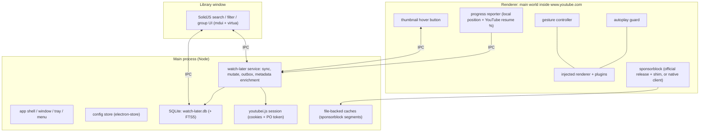

# PRD — YouTube desktop wrapper (working title: **Watchdeck**)

**Status:** approved in outline — **P1 done**; P2–P4 in progress; P3's SponsorBlock path decided by the spike (§5.1).
**Revision 4** — P0 work has begun: the project folder is renamed and the repository is published, the music-only plugin
inventory is deleted, and the §R8 debrand gate passes. Decisions and open questions are unchanged; §8 and §15 list what
is left in P0.
**Revision 5** — owner review of the P0 diff: the `\u` escapes stay in code and package metadata (§R8), `auto-changelog`
and the upstream-shaped CI (including the winget workflows) are kept, and the README keeps the upstream section layout.
**Revision 6** — Q2 answered (keep the neutral plugins in tree) and the Ultracite migration landed; the deviation list
in `oxlint.config.ts` is measured, not guessed.
**Revision 7** — **P0 is done**: the version sweep landed with four documented pins, `docs/plugins.md` is written, and the
first real bug the reset caused (the store typing behind `config.get`) is fixed.
**Revision 8** — the owner re-prioritised: **Watch Later first**, not the P1 base. The service, the account-aware schema,
the sync engine with resumable paging, the quick-add hover button and account switching (which replaces the single-account
assumption of Q12) are in as a plugin, with unit tests. The Library window is next; P1's provider rework follows.
**Revision 11** — **P1 is done**, and the hover button was reworked twice to get there. The player bridge (`video-info` /
`video-controls`) replaced the music-era providers; the window gained a Playback menu (the app's own UI for
play/pause, seek, volume, mute); autoplay stays off by default and a navigation the user asked for is left alone; gestures
(right-drag volume/seek, shift+right-drag speed, right+wheel volume) ship with a readout; the smoke test asserts the page
instead of skipping it. R4's placement is now pointer-driven and the button, not the card, is what floats above the site's
inline preview — rev 10 raised the card and hid the preview behind it, which is recorded in R4 because it is the kind of
mistake that gets made twice. **Q6 is answered** (§13), so no question in this document is open any more. What P1 knowingly
left behind lives in `TODO.md`, not here.
**Revision 12** — **the SponsorBlock spike passed**, so §5.1's Option A (the official extension release, downloaded at
runtime and patched with a shim) is the shipping path: service worker, in-player skipping, config across restarts,
enable/disable without a restart, and a cold start with no network were each verified live, and the numbers are in §5.1.
Two things the spike measured are worth more than the verdict: SponsorBlock's own settings page and popup are
unreachable in Electron (so the user gets its defaults), and a plugin's `index.ts` is shared by every bundle, where a
module-scope call that only belongs to the main process can kill the injected page half — the smoke test is what
caught it, and §5.1 records how.
**Previously** (rev 3) — the name is decided (**Watchdeck**), the git reset is done, and §15 was added as the handoff note for the next thread.
**Previously** (rev 2) — incorporates erikenz's review comments (progress from YouTube's own resume indicator, Ultracite via `ultracite init`, debrand directive, naming criteria) and a read-only review of the `~/Projects/watchdeck` prototype.
**Origin thread:** [Research YouTube wrapper requirements](delta://thread/ksQQtJ1g3qomQKOnuQmLwMFfRJLOAATRZpIBxBC_dFj9xJZPkJI4nq3kXvYt) — see §15.
**Author:** Delta agent, for erikenz.
**Source of truth for:** scope, verified research, architecture decisions, open questions.

> This document is the deliverable of the "research first, PRD, confirm, then build" step you asked for.
> Everything under *Verified findings* was measured or read directly (codebase, package registries, official docs, and a
> signed-out headless Chromium probe of youtube.com). Everything under *Open questions* needs your answer before I write code.

---

## 1. Summary

The workspace is a clone of [`pear-devs/pear-desktop`](https://github.com/pear-devs/pear-desktop) (itself a fork of
`th-ch/youtube-music`): an Electron app that loads `music.youtube.com` in a `BrowserWindow` and injects a plugin
framework that talks to the page's `#movie_player` API and the YouTube Music DOM.

What we are building instead: **a desktop wrapper for `www.youtube.com`** with a first-class Watch Later experience,
SponsorBlock, autoplay control and mouse gestures — with the pear-desktop plugin framework reused where it is good, and
the bulk of its 41 YouTube-Music plugins dropped.

The single most important research result: **the base plate is reusable, the plugin inventory is not.** The player API
surface (`#movie_player`, `videodatachange`, `getPlayerResponse()`) exists on `www.youtube.com` and behaves like it does
on YTM (verified below), but almost every plugin also depends on YTM-only DOM (`ytmusic-*`, `ytd-*`), YTM-only routes
(`FEmusic_*`), or YTM-only music metadata. So the plan is: keep the framework, delete the inventory, build ~8 new
plugins for YouTube.

---

## 2. Decision summary (TL;DR for review)

| # | Topic | Recommendation | Needs your answer? |
|---|-------|----------------|--------------------|
| D1 | Project name | **Watchdeck** — decided (chosen over Lounge; `lounge` on npm is The Lounge IRC client, `watchdeck` is free) | no (Q1 answered) |
| D2 | YouTube Music support | Drop it entirely; target `www.youtube.com` only | **yes — Q2** |
| D3 | Plugin inventory | Delete the YTM-only plugins; ship a documented plugin API + authoring guide in P0 so contributors can add their own | **yes — Q2** |
| D4 | Watch Later storage | SQLite via built-in `node:sqlite` (FTS5 verified on Node 24); DB owned by the main process | no (impl detail) |
| D5 | Watch Later sync | Main process, `youtubei.js` + session cookies (same pattern as the inherited downloader); mutations may go page-side via `window.ytcfg` if account handling requires it | no (impl detail, §4.2) |
| D6 | Watch Later UI | **In-page, in v1** (rev 9): a toolbar above the page's own sort control, filters that hide the page's own rows, per-row context lines. No separate Library window. | no (Q3 answered) |
| D7 | Hover "add to Watch Later" button | Hosted on the **card** (the inline preview lives outside the thumbnail link), bottom-right **above** the duration badge, one offset in every state, always visible once saved, clock glyph filled/outline for state, skipped on the Watch Later page itself | no (Q4 answered) |
| D8 | SponsorBlock | Load the **official extension release at runtime** with a small compat shim (**revised** — see §5.1); native client only as fallback. The spike passed on all five criteria, so this is the shipping path | no (spike passed — §5.1) |
| D9 | Disable autoplay | One-shot capturing `play` listener → `video.pause()`, armed on `yt-navigate-finish`/`popstate`; plus click YouTube's toggle to enforce off (`aria-checked` flip verified — `setAutonavState()` is a **no-op**). Since rev 11: a navigation the user asked for (a click on a link or thumbnail, or one of the app's own playback commands) is not blocked | no (shipped) |
| D10b | Watch progress source | `max(local high-water mark, YouTube's own resume %)` — the resume % is available per item as `thumbnailOverlays[].thumbnailOverlayResumePlaybackRenderer.percentDurationWatched` (**revised** — see §4.3) | no (evidence-backed) |
| D10 | Gestures | Own pointer-state tracking + wheel/pointer movement; right-drag = volume, right-drag horizontal = seek, shift+right-drag = speed, right+wheel = volume (shipped in P1 with a readout) | no (Q6 answered) |
| D11 | Lint/format | `pnpm dlx ultracite init --linter oxlint --pm pnpm --frameworks solid --type-aware` (command you specified), replacing `.oxlintrc.json`/`.oxfmtrc.json`; documented suppression list for type-aware rules that even the prototype had to disable | no (Q8 answered) |
| D12 | Versions | Exact pins everywhere (already the case) + `save-exact=true`; no pre-release pins — stable equivalents exist for all of them | no — resolved in §5.5 |
| D13 | Git history | **Done**: fresh repo `main`, upstream `.git` backed up, folder renamed to `~/Projects/watchdeck`, published to `origin` (§11) | no (Q10 done) |

---

## 3. Verified findings

### 3.1 Inherited architecture (what we keep)

| Layer | File(s) | Verdict |
|-------|---------|---------|
| Electron shell, window, tray, menu, i18n, auto-update | `src/index.ts`, `src/menu.ts`, `src/tray.ts` | keep, debrand, harden |
| Config store (electron-store + typed `get`/`set` + `watch`) | `src/config/*` | keep as-is |
| Plugin framework (backend / preload / renderer lifecycles, per-plugin config, hot enable/disable) | `src/loader/*`, `src/utils/index.ts`, `src/types/plugins.ts`, `vite-plugins/plugin-*.mts` | keep — this is the good part |
| Renderer injection into the page's **main world** | `src/preload.ts` + `src/index.ts` (`get-renderer-script`) | keep, but re-review (see §3.3) |
| Player/track providers | `src/providers/song-info*.ts`, `song-controls.ts`, `app-controls.ts` | rework for YouTube |
| 41 plugins under `src/plugins/` | — | delete inventory, keep ~0–3 |

Plugin mechanics worth knowing for the rewrite:

- A plugin is `src/plugins/<name>/index.ts` (or a single file) exporting `createPlugin({ name, description, config, menu, backend, preload, renderer, stylesheets })`.
- `vite-plugins/plugin-loader.mts` rewrites each plugin at build time: it strips contexts not needed for the current
  bundle and emits a `pluginStub` export. Contexts: `backend`, `preload`, `renderer`, `menu`.
- `vite-plugins/plugin-importer.mts` generates `virtual:plugins` (dynamic imports for main, static for preload/renderer,
  plus platform filtering).
- IPC `peard:*` and DOM ids `ytmd-*` are the inherited name prefixes; `LoggerPrefix = '[YTMusic]'`.

### 3.2 YouTube vs YouTube Music — measured, not guessed

Probed with headless Chromium against `www.youtube.com` (signed out, default 1280×633 viewport, player 880×495).

**Player API (present on `www.youtube.com`)**

| Something | Result |
|-----------|--------|
| `#movie_player.addEventListener('videodatachange', (name, data) => …)` | **fires**, names `dataloaded` then `dataupdated` — same contract the existing `song-info-front.ts` uses |
| `getPlayerResponse().videoDetails` | `title`, `lengthSeconds`, `keywords`, `shortDescription`, `channelId`, `author`, `viewCount`, `isLive`, `isLiveContent`, `thumbnail`, `isPrivate`, `allowRatings`, … |
| `getVideoData()`, `getProgressState()`, `getCurrentTime()`, `getDuration()`, `getVolume()`/`setVolume()`, `playVideo()`/`pauseVideo()`, `seekTo()` | all present |
| `setAutonavState()` | present but **did nothing** (`aria-checked` unchanged) → treat as unusable |
| `getAutonavState()` | **absent** |
| `#progress-bar` (YTM) | **absent** → time tracking must move to `<video>` `timeupdate` / `.ytp-progress-bar[role=slider][aria-valuenow]` |
| `#like-button-renderer` (YTM) | **absent** → like/dislike features that depend on it need rework (`like-button-view-model` / `#top-level-buttons-computed` instead) |

**DOM metrics relevant to the hover button** (this is the number you asked me to match)

| Element | Measurement |
|---------|-------------|
| `ytd-thumbnail` (search result, 500×281) | `position: relative` → safe host for an absolutely positioned button |
| `ytd-thumbnail-overlay-time-status-renderer` (duration badge) | **68×20 px**, inset **8 px** from right and bottom, font-size **10 px**; inner badge 64×20 |
| `.ytp-chrome-controls` | height **40 px** |
| `.ytp-mute-button` | **40×40** |
| `.ytp-subtitles-button` (CC) | **48×40** |
| `.ytp-settings-button` | **48×40** |
| `.ytp-button` default | `padding: 12px` |
| `.ytp-chrome-bottom` | 59 px tall in this window size |

So "the same size as YouTube's mute/CC button" = **40 px tall, 40–48 px wide** in the default window size; in big-mode
(fullscreen/very large player) YouTube scales these up. A hover-overlay button that visually matches the *thumbnail*
overlays would instead be ~28–32 px. Pick one — see Q4.

**Interactions verified**

- Clicking `.ytp-autonav-toggle-button` **flips `aria-checked` `true` → `false`** → this is the reliable way to force
  autoplay off (confirmed by DOM read-back, not by the API).
- Right-click while scrolling did *not* surface `WheelEvent.buttons === 2` through the CDP harness, so I could not confirm
  the browser-side bitmask. Consequence for design: **do not depend on `event.buttons`**; track right-button state from
  our own `mousedown`/`mouseup`/`pointercancel` listeners (see §5.6).

**Not verifiable here (you must validate on your machine):** the logged-in hover-preview controls on thumbnails, the
watch-later page layout, and YouTube's A/B-tested variants for the thumbnail overlay bar. YouTube's signed-out headless
surface differs from a real profile.

### 3.3 Inherited code: critical review (as requested)

| Sev | Finding | Why it matters |
|-----|---------|----------------|
| high | `electron-updater` points at `https://github.com/pear-devs/pear-desktop/releases/latest` (`src/index.ts:821`) and `options.autoUpdates` defaults to `true` | a released build of your app would offer to install pear-desktop. Must be disabled or repointed before the first build |
| high | Product identity is upstream everywhere: `package.json` `name`/`productName`/`desktopName`, `appId: com.github.th-ch.youtube-music`, `app.setName(...)`/WM_CLASS (Linux), Windows `AppUserModelId`, Start-Menu shortcut path, tray/desktop-entry names | broken shortcuts, two apps fighting over one identity, AppUserModelID collisions |
| high | `webPreferences.sandbox: false` in production (`src/index.ts:369-379`) | the preload has full Node access in a page that renders third-party content. Consider `sandbox: true` + moving privileged work to main, or an explicit risk note |
| med | `protocol.registerSchemesAsPrivileged` hijacks `http`/`https` globally and `removeContentSecurityPolicy()` strips CSP from every `https:` response while injecting `access-control-allow-origin: https://music.youtube.com` | needed for the injection architecture, but it is a wide attack surface; re-evaluate scope for youtube.com |
| med | `typescript: 7.0.1-rc`, `electron-vite: 6.0.0-beta.1`, `butterchurn@3.0.0-beta.5` | pre-release pins in a new project; the TS 7 RC also interacts with `oxlint-tsgolint` type-aware linting |
| med | `version: 3.12.0`, upstream `changelog.md`, `renovate.json`, `.github/workflows/winget-*.yml`, AUR/scoop/winget copy | inherited release identity; winget workflow would try to publish to *their* packages |
| med | Test coverage is one Playwright smoke test that asserts the URL is `music.youtube.com` (`tests/index.test.js`); no unit tests anywhere | nothing protects the sync/DB logic we are about to write |
| low | `src/pear-desktop.ts` is actually `declare module '*.css'`-style vite typings, not app code | misleading name; rename to `src/vite-env.d.ts` |
| low | `web/screenshot.png` (778 KB), `assets/icon.svg` + `assets/generated/**` icons, `patches/*` (5), Weblate i18n for ~40 locales | mostly upstream branding/music strings; needs pruning |
| low | "youtube" is written as `\u0079\u006f\u0075...` escapes in ~50 places | upstream de-trademarking artifact; unreadable, ungreppable. Use plain strings in the new project |
| low | `src/plugins/audio-compressor.ts` is an orphan single-file plugin; `tools/eslint-core-plugin.mjs` becomes obsolete with Ultracite | dead weight after the reset |

Nothing here changes the plan, but items 1–3 must land in phase 0, before any release build exists.

### 3.4 Prototype review — `~/Projects/watchdeck` (read-only reference)

You asked me to treat the prototype as reference only and keep pear-desktop as the primary influence. I read it without
editing anything; it is useful less as architecture (you are right that it is messy — e.g. a single 2 473-line preload
file) and more as a **source of verified YouTube facts** that confirm or correct my own findings:

| Taken from the prototype (as fact, to re-verify in a spike) | Correction/decision for this PRD |
|---|---|
| `thumbnailOverlays[].thumbnailOverlayResumePlaybackRenderer.percentDurationWatched` is YouTube's own per-item watch progress — read from item data, i.e. it arrives **for free with a playlist/browse response** | This answers your comment: YouTube's own progress indicator *can* be used, and better than I assumed. Adopted into `R1`/§4.3 as a second progress source |
| DOM equivalent: `.ytwThumbnailOverlayResumePlaybackRendererThumbnailOverlayResumePlaybackProgress`, `ytd-thumbnail-overlay-resume-playback-renderer #progress`, `[class*='ResumePlaybackProgress']` (read `style.width` as `%`, else measure widths) | Adopted as the DOM fallback for live pages; one selector module, not scattered strings |
| A separate "Watched" badge exists: `ytd-thumbnail-overlay-playback-status-renderer` / `ytw-thumbnail-overlay-playback-status-renderer` containing the word "watched" | Adopted as an additional watched signal (surface-dependent — treat as a hint, not truth) |
| `e.buttons === 2` on `wheel` **does** work in the real browser (their gestures plugin relies on it) | My earlier "do not trust `buttons`" was a CDP harness artifact. Design now uses `e.buttons === 2` with a tracked-state fallback (§5.6) |
| Setting `video.volume` and dispatching a `volumechange` event keeps YouTube's own volume UI in sync; HUD can be appended to `#movie_player` | Adopted |
| SPA navigation events `yt-navigate-finish` and `popstate` fire and are usable for arming/disarming behaviours | Adopted — simpler and more robust than `videodatachange` for autoplay control |
| `node:sqlite` `DatabaseSync` + FTS5 + triggers + `MATCH`/`rank` + LIKE fallback **inside an Electron main process** | Confirms the SQLite decision of §5.4 empirically (not just on host Node) |
| Ultracite 8.0.1 config shape produced by `init` for Oxlint, incl. the type-aware rules they had to turn off to get a green run | Adopted for the migration plan (§5.3) |
| Loading the **real** SponsorBlock release into Electron with a `chrome.storage.sync → storage.local` shim, MV3 service-worker notes, extension-dir-versioned caching | Revises §5.1: option B is viable; now the recommended primary with a spike |
| New-generation thumbnail hosts (`ytThumbnailViewModelHost`, `a.ytLockupViewModelContentImage`, `yt-thumbnail-view-model`) in addition to `ytd-thumbnail` | Adopted into the hover-button host list (R4) |

**Deliberately not taken** (evaluated and rejected): the in-page Watch Later UI on `playlist?list=WL` as the *primary* surface
(proven feasible, but it is what made the prototype monolithic and DOM-fragile — kept as phase 4, see Q3); DOM-scraping as the
*read path* for the list (replaced by resumable InnerTube `VLWL` paging, which also yields `setVideoId`); per-feature
ad-hoc settings UIs (replaced by plugin config + one Library window). Its own `db.ts` schema and thresholds heuristic were
read for reference only — the schema in R1 is mine (entry ids, sync runs, outbox, provenance columns) because the prototype
did not need re-add safety or resumable sync.

---

## 4. Research: Watch Later (the core feature)

### 4.1 Why a local database is the right answer

- The Watch Later list is the internal playlist `WL` (`https://www.youtube.com/playlist?list=WL`).
- The **official YouTube Data API cannot read `WL` at all** — Google blocked third-party access to it in 2016 (only
  `HL`, the history list, was ever exposed, and it is broken too). Any implementation must use **InnerTube**, the private
  API the web client itself uses, authenticated with your own session cookies.
- InnerTube returns playlist pages of about **100 items** with `continuation` tokens (`youtubei.js`'s `getPlaylist()`
  returns the first 100 and requires `has_continuation` + `getContinuation()` loops to get the rest). A 2 000-item list is
  ~20 round trips — fine for a background sync, unusable as a UI.
- There is **no search endpoint for playlists** and no per-item "watched" flag in the playlist response, so search,
  filtering and grouping must be local. That is exactly what you asked for.

### 4.2 Endpoints and payloads (verified in the wild, incl. YouTube's own menu data)

```jsonc
// read a page (first page: no continuation; later pages: continuation token from the previous response)
POST https://www.youtube.com/youtubei/v1/browse
{ "context": { "client": { "clientName": "WEB", "clientVersion": "…" } }, "browseId": "VLWL" }

// add to Watch Later — this is the payload YouTube's own "Save to Watch Later" menu item sends
POST https://www.youtube.com/youtubei/v1/browse/edit_playlist
{ "playlistId": "WL", "actions": [ { "action": "ACTION_ADD_VIDEO", "addedVideoId": "<videoId>" } ] }

// remove from Watch Later — removal is keyed by the per-entry id, not the video id
{ "playlistId": "WL",
  "actions": [ { "action": "ACTION_REMOVE_VIDEO", "setVideoId": "<setVideoId from the list response>" } ] }
```

Consequences for the design:

1. `setVideoId` must be stored per entry (it changes when a video is re-added) → part of the sync, not an afterthought.
2. Every mutation needs the page/response context; the same session that is logged in must perform the call.
3. `youtubei.js` (already a dependency, `17.2.0`; latest is `18.1.0`) exposes `Playlist` (`items`, `has_continuation`,
   `getContinuation()`, `info.total_items`) and a `PlaylistEditRequest` type for `/browse/edit_playlist`, plus cookie and
   BotGuard/PO-token support — the inherited `downloader` plugin already implements cookie extraction
   (`session.cookies.get`) + PO-token generation (`bgutils-js`) in the main process. We reuse that pattern.
4. Caveat: multi-account sessions need `X-Goog-AuthUser` / `SESSION_INDEX`; `youtubei.js`'s `account_index` is known to be
   unreliable (upstream issue #735). Design assumption: **the active (first) account of the browser session** — see Q12.

### 4.3 Where the watched/continue-watching numbers come from (revised)

You are right that YouTube's own resume indicator is usable, and it is better than I first claimed. There are **three**
sources, and the design uses all of them:

1. **YouTube's own resume percentage, per item — free with the sync.** Playlist/browse items can carry
   `thumbnailOverlays[].thumbnailOverlayResumePlaybackRenderer.percentDurationWatched` (integer percent). Because a full
   `VLWL` sync already walks every item, the sync can store this without a single extra request. This is exactly the
   "watch progress bar indicator" you meant, and it is the source that also covers videos you watched *before*
   installing the app — the gap I originally called out as a limitation.
2. **The same value in the DOM**, for pages we are already looking at:
   `ytd-thumbnail-overlay-resume-playback-renderer #progress` (and the newer
   `ytwThumbnailOverlayResumePlaybackRendererThumbnailOverlayResumePlaybackProgress` /
   `[class*='ResumePlaybackProgress']`), where the width is either an inline `%` or has to be measured against its parent.
   Useful as a cross-check and for videos that are added to WL mid-session.
3. **Local high-water mark** from our own tracking (`video.currentTime` / `getProgressState()` while a video plays),
   which is the only source that knows about precision, per-session detail, and re-watches.

**Classification rule (revised):** `effective_ratio = max(local_max_position / duration, yt_percent / 100)`, where
`yt_percent` is refreshed on every sync. Everything else in R1 (thresholds, buckets, query-time re-classification) stays as
specified — the thresholds are applied to `effective_ratio`, so "configure a min %/minutes" still works exactly as you asked.

Known limits, to be honest about and to surface in the UI:

- YouTube only publishes a resume percentage for **partially watched** videos. A finished video has no resume bar, and a
  never-started video has none either — so **absence is ambiguous** and must never be read as "unwatched".
- The percentage is coarse (whole numbers) and is the *furthest* position YouTube recorded, not accumulated watch time; a
  throwaway scrub to 95 % counts as 95 %. The optional "Watched" badge
  (`ytd-thumbnail-overlay-playback-status-renderer`, text contains "watched") is a second signal for fully-watched videos
  where YouTube decides to render it.
- It is per Google account, so it arrives with the session that the sync uses (see §4.2 note on `X-Goog-AuthUser`).
- Provenance is stored per row (`progress_source`: `local`, `youtube`, or `both`), so the Library UI can show where a
  number came from and a future setting can prefer one source over the other.

---

## 5. Research: the other requirements

### 5.1 SponsorBlock — revised after the prototype review

The prototype proves something my first pass got wrong: **the official SponsorBlock release does load and work inside
Electron**, with a small compatibility shim. Concretely, from its `sponsorblock/extension.ts` + `backend.ts` (read-only):

- the release (`ChromeExtension.zip` from GitHub releases) is downloaded at runtime into `userData` and loaded with
  `session.extensions.loadExtension(dir, { allowFileAccess: true })`;
- Chromium runs the MV3 **service worker** background well enough, but `window` is absent there, which breaks maze-utils'
  config reads;
- Electron exposes `chrome.storage.local` but **no usable `chrome.storage.sync`** — SponsorBlock's config layer calls
  `sync.get(null, cb)` and waits on `sync.onChanged` for `Config.isReady()`, so a missing `sync` both throws and leaves the
  config permanently unready. Aliasing `sync` onto `storage.local` fixes it;
- Electron derives an unpacked extension's id from its **path**, and Chromium caches the service-worker script by that id,
  so the shim version must be part of the directory name to invalidate the cache.

Both options, for the record:

| | Option A — load the official extension (recommended, with a spike) | Option B — native client against the public API (fallback) |
|---|---|---|
| Feature coverage | full: skip/mute/full/poi, category UI, segment highlight on the progress bar, votes, auto-updates | only what we implement (skip/mute/full/poi + categories + cache), forever behind upstream |
| Maintenance | upstream maintains behaviour; we maintain a ~50-line shim + the update/download path | we own everything, including every YouTube player change |
| Licensing | GPL-3.0 code is **not bundled**: the user's machine fetches the official release at runtime, so SB stays a separate program (an about-dialog note + download consent is still good practice) | no SB code at all |
| Electron gaps | `chrome.action` popup and `options_ui` are unreachable → SB's standalone settings window/popup is not available; the in-player SB UI (content script) is what works | we build our own settings UI |
| Risk | shim breaks on an upstream release; download needs network on first use; unpacked-extension loading is not a documented Electron feature | more of our own code, less feature parity |

**Plan:** P3 starts with a bounded spike (≤1 h): load the current release with the shim, then verify (a) the background SW
runs, (b) the SponsorBlock button/menu appears in the player and skipping works, (c) config survives a restart,
(d) the extension can be disabled/enabled from our menu, (e) cold start with no network still gives a usable app.
If (a)–(e) pass → Option A ships as the default with an explicit "download SponsorBlock from its official release"
consent step, and Option B stays untouched. If they fail → Option B, implemented as specified in revision 1
(`{api}/api/skipSegments/{sha256HashPrefix[4]}`, `actionType` handling, per-category toggles incl. `music_offtopic`,
segment cache in SQLite, optional `userID` for later voting).

**Spike result (rev 12): all five pass, Option A is the default.** SponsorBlock 6.1.7, downloaded from its GitHub
release into `userData/sponsorblock-extension-wd1/`, patched with the shim, loaded with
`session.extensions.loadExtension`:

| | Evidence |
|---|---|
| (a) background runs | `session.serviceWorkers.getAllRunning()` lists `chrome-extension://…/js/background.js` |
| (b) skipping works | on a video with a sponsor segment `[83.449, 106.491]`: playback at 80.0 s was at **108.9 s** six seconds later; a video with an intro segment `[0, 2.769]` starts playback at 3.7 s. SB's own notice and icons render (the icons come from a per-session dynamic extension id and load fine) |
| (c) config survives a restart | `categorySelections: [{name: intro, option: 2}]` written through the extension's own `chrome.storage.sync` (aliased to `local` by the shim) was still there after a full restart, and the intro was skipped on the cold run |
| (d) enable/disable without a restart | toggling the plugin removes/loads the extension on the live session (`extension unloaded` → SW target gone → no skipping, no leftover DOM; enable → loaded to the SW target → skipping resumes). Both directions reload the page, which is what makes the change reach the page |
| (e) cold start offline | with the release check failing (`ECONNREFUSED`), the installed copy still loads and the plugin starts in 25 ms; with nothing installed, it logs `no extension on disk and none could be downloaded` and the app is unaffected |

**What the spike settled, besides the verdict:**

- **SponsorBlock's own settings UI cannot be reached from Electron**, and this is now measured, not assumed:
  `chrome-extension://<id>/options/options.html` fails with `ERR_FILE_NOT_FOUND`, and registering the
  `chrome-extension` scheme ourselves to work around it aborts the app (SIGTRAP). So the extension's options page and
  toolbar popup are both unavailable, and the in-player notice has no settings entry — with Option A the user gets
  SponsorBlock's defaults. Everything the app itself configures is ours (`mode`, `autoUpdate`, plugin on/off); the
  extension's own storage does respond to writes (proved in (c)), so a small settings surface of our own is possible
  later, at the cost of tracking its config schema. Recorded as a known limitation, not a bug to fix.
- **A plugin's `index.ts` is shared by every bundle, so nothing main-process-only may run at its module scope.**
  `import is from "electron-is"` reached from page-reachable code, and a `z.object(...)` call at the top of a module
  only the main process uses, both pulled CommonJS wrappers into the injected page bundle, where `require` does not
  exist — the whole page half died silently. Static imports that are only *referenced* from a stripped context are
  fine (they are tree-shaken); calls at module scope are not. The smoke test caught it, which is why that test asks
  the page whether `wd-trans` came up.

**Shipping Option A still needs** (not part of the spike): the first-use "download SponsorBlock from its official
release" consent step; falling back to the native client automatically when no extension can be loaded; and a note in
the about dialog (GPL-3.0, separate program, settings reachable only through SponsorBlock's in-player UI).

### 5.2 Disable autoplay

Two distinct behaviours, both configurable (the inherited plugin only does the second):

1. **Enforce autoplay = off**: click `.ytp-autonav-toggle-button` until `aria-checked === 'false'` (verified working).
   `#movie_player.setAutonavState()` must not be used — it is a silent no-op (verified).
2. **Stop auto-advance**: arm a one-shot capturing `play` listener on `document`, and pause on the first play that follows
   a navigation — armed on `yt-navigate-finish` and `popstate`, disarmed on timeout so a deliberate click always works.
   The prototype uses exactly this (and it is more robust than my earlier `videodatachange`+`pauseVideo` proposal, because
   it catches every play path, including playlist auto-advance).

The inherited plugin's config shape (`enabled`, `applyOnce`) is fine; the prototype's `blockOnLoad` / `blockOnNavigation`
split is a better default set and I will adopt it (`applyOnce` kept).

### 5.3 Ultracite + Oxlint (setup command fixed)

Setup is exactly the documented flow you asked for, run once in the repo root:

```bash
pnpm dlx ultracite init --linter oxlint --pm pnpm --frameworks solid --type-aware
```

What that produces (verified against the prototype's committed output, which was generated by the same command):

- `oxlint.config.ts` — `defineConfig({ extends: [core, solid, …, jsPlugins], options: { typeAware: true }, rules: { … } })`,
  importing `ultracite/oxlint/core`, `ultracite/oxlint/solid`, `ultracite/oxlint/vitest`, `ultracite/oxlint/anti-slop` and
  `ultracite/oxlint/js-plugins`;
- `oxfmt.config.ts` — `{ ...ultracite }` from `ultracite/oxfmt` plus our ignore patterns;
- `AGENTS.md` — Ultracite's code standards (our repo has none today; taking it is a bonus);
- deletion of `.oxlintrc.json` / `.oxfmtrc.json`, and the **installed** versions the preset was verified with:
  `ultracite 8.0.1`, `oxlint 1.88.0`, `oxfmt 0.73.0`, `oxlint-tsgolint 7.0.2004`, `typescript 7.0.2` (the prototype's set,
  which lints cleanly together — the repo's current `oxlint 1.71.0` / `oxfmt 0.56.0` / `oxlint-tsgolint 0.23.0` satisfy
  neither);
- commands become `ultracite check` / `ultracite fix` (`--unsafe`, `--type-check` available); `package.json` `lint` /
  `format` / `format:check` / `check` get rewired, and CI runs `ultracite check` + `typecheck`.

**Migration reality check (from the prototype, not theory).** Even in a greenfield project, `--type-aware` flags enough
that these rules had to be turned off to get a green run: `typescript/await-thenable`, `no-confusing-void-expression`,
`no-floating-promises`, `no-misused-promises`, `no-unnecessary-type-arguments`, `no-unsafe-argument`,
`no-unsafe-assignment`, `prefer-nullish-coalescing`, `prefer-readonly`, `prefer-regexp-exec`, `promise-function-async`,
`return-await`, `strict-boolean-expressions`, `strict-void-return`. On a ~40 k-line inherited codebase the same list (plus
`complexity`, `import/no-cycle`, `unicorn/*`) will fire far more often.

**Therefore: fix-first, then a documented suppression list — not a full-repo rewrite.** Order: (1) delete the plugin
inventory and debrand *first* (§R5, §R8), (2) run `ultracite fix` on what remains, (3) triage the leftovers: fix the cheap
ones, and for the type-aware/strictness rules above, commit an explicit override block with a one-line reason each (the
prototype's config shows the pattern and its comment is the right tone). No blanket `ignorePatterns` — those hide new code
too. That is my answer to Q8(a)/(b); if you want the opposite (fully clean baseline, large one-off diff), say so.

Also set `.npmrc` `save-exact=true` so "no carets" holds for future installs, and keep the inherited `minimumReleaseAge`
guard in `pnpm-workspace.yaml`.

### 5.4 SQLite in Electron — options compared

| Option | Verdict |
|--------|---------|
| `node:sqlite` (built-in, Node ≥ 22.5, no flag since Node 23.4) | **Recommended and empirically confirmed.** Verified on this machine (Node 24.21: `DatabaseSync`, FTS5 virtual tables, bm25, SQLite 3.53.4) **and** independently confirmed inside an Electron main process by the prototype (`DatabaseSync` + FTS5 + triggers + `MATCH`/`rank` + `LIKE` fallback in `src/db.ts`). Wrap it in a thin `Db` interface because Node still marks it experimental. |
| `better-sqlite3` | Fallback. Always ships FTS5, but is a V8-native addon: needs `electron-rebuild`, an entry in `pnpm-workspace.yaml` `allowBuilds`, and has a *different ABI from host Node* (so scripts/tests cannot share the binary). |
| `sql.js` / WASM | Rejected: whole-DB-in-memory, awkward persistence for a 10 k-row corpus. |

Because both real options are synchronous APIs with near-identical shapes (`prepare/get/all/run`), the DB layer should be
written against a tiny adapter interface so swapping is a 30-line change.

### 5.5 Package-version policy

- "Latest possible, no carets": already true for the inherited manifest (all exact). Add `.npmrc: save-exact=true`,
  keep `engineStrict`, and rewrite `renovate.json` for the new repo (it currently carries pear-desktop's config).
- Tension resolved: the pre-release pins can go, because stable equivalents exist. The prototype runs
  `typescript 7.0.2` (stable), `electron-vite 6.0.0` (stable), `ultracite 8.0.1` + `oxlint 1.88.0` + `oxfmt 0.73.0` +
  `oxlint-tsgolint 7.0.2004` and `electron 44.7.2`, `vite 8.3.4`, `mdui 2.1.5`, `solid-js 1.9.17`, `zod 4.6.7`,
  `vitest 5.0.5`. Treat that as a *starting snapshot*, not gospel: re-resolve each with `pnpm outdated` /
  `pnpm update --latest` at implementation time and re-verify `ultracite check` after each bump. The inherited RC/beta pins
  (`typescript 7.0.1-rc`, `electron-vite 6.0.0-beta.1`) go away; `butterchurn*` becomes moot if the visualizer plugin is
  deleted per R5.
- Dependencies that can go once the YTM plugin inventory is deleted (examples): `butterchurn*`, `vudio`, `@foobar404/wave`,
  `kuroshiro*`/`kuromoji`/`hanja`/`pinyin-pro`/`@indic-transliteration/sanscript`/`chinese-conv`/`es-hangul`
  (lyrics-language tooling), `peerjs` (music-together), `howler`, `@jellybrick/mpris-service`, `@xhayper/discord-rpc`
  (keep only if the corresponding plugin survives), `youtubei.js` (**keep** — needed for sync + downloads).

### 5.6 Gestures: what is actually implementable

- Wheel/pointer events reach the page; the inherited `precise-volume` plugin proves wheel capture works in this container
  (on YTM), and the prototype's gestures plugin proves it on YouTube. Surface for gestures: `#movie_player`,
  `.html5-video-player`, `#player`, `video` (+ `document.fullscreenElement` ⇒ always armed).
- **Right-button detection works in practice**: the prototype gates its wheel handler on `e.buttons === 2` and it works on
  YouTube. My CDP probe could not simulate that bitmask — that was a harness limitation, not a browser one. Design:
  primary check `e.buttons === 2`, plus our own tracked button state as a fallback (covers exotic platforms/pointer kinds),
  `{ passive: false }` on the wheel listener, and `contextmenu` suppressed with a capturing listener only after a
  gesture actually fired (so a plain right-click still opens YouTube's menu).
- Volume should be applied as `video.volume = x` + `new Event('volumechange')` dispatch, so YouTube's own volume UI and
  its `mute` state stay in sync (verified approach in the prototype); the HUD is appended to `#movie_player`.
- Reset state on `blur` / `pointercancel` / navigation so a gesture can never get stuck.
- Sensible v1 set: right+wheel → volume (the gesture you named), right-drag vertical → volume, right-drag horizontal →
  seek, shift+right-drag → playback speed. Everything else (frame step, mute, zoom, nothing) lives in the same mapping
  table, config-only.
- Keep YouTube's own interactions intact: double-click fullscreen, `k`/`j`/`l`, click-to-pause, and the native context
  menu outside the player area.

---

## 6. Proposed architecture



Data flow for the quick-add button (the round trip that must feel instant):

1. Renderer keeps an in-memory `Set<videoId>` of Watch Later membership, hydrated from main on startup and kept in sync.
2. Click → optimistic UI (spinner→filled icon) → `ipc.invoke('wl:add' | 'wl:remove', videoId)`.
3. Main performs the InnerTube mutation, updates `wl_entry` + `video`, returns the new authoritative state.
4. Renderer updates the set (and every other visible thumbnail reflects it), or reverts + shows a toast on failure.
5. If offline/unauthorized the mutation goes to an `outbox` table and is replayed on the next sync.

---

## 7. Requirements → design

### R1 — Enhanced Watch Later

> **Status (rev 9): implemented as `src/plugins/watch-later/`, in the page.** Schema (account-scoped), sync engine with
> resumable paging, metadata enrichment, YouTube-resume capture, the quick-add hover button (R4). The Watch Later page
> itself is enhanced in place: a toolbar above the site's own sort control (search, filter chips with live counts, sync
> controls, progress), per-row context lines (bucket · watched % · saved date) and filters that **hide the page's own rows**
> rather than render a list of ours. Rev 9 also overturns rev 8's account handling: **no Library window, no account picker,
> no account submenu** — accounts are switched only through the site's own avatar menu, and the plugin follows the account
> the page is browsing as (it reports `SESSION_INDEX`, which the backend adopts). Covered by unit tests for the store, the
> page parsers and the sync engine; the in-page surface has no automated tests yet and is checked against the live page
> (a fixture harness for it is queued in §15). Remaining: OS-level entry points and the P4 polish list (§8).

**Database schema (SQLite, main process, `userData/watch-later.db`)**

The tables below are the revision-1 sketch. What shipped adds the account dimension: `account` (id, name, handle, photo,
`index_in_list` = the `X-Goog-Authuser` index, selected flag), an `account_id` key on `wl_entry` and `progress`, a
`sync_cursor` table that makes paging resumable, and a `video` table that stays account-independent (the same video has the
same title in every account). `video_fts` is kept current by triggers, and the classification rule gained one fix: the
"continue watching" band reaches up to the watched threshold, so raising `watched.percent` cannot leave a video that is
in neither bucket.

```sql
CREATE TABLE video (
  video_id            TEXT PRIMARY KEY,
  title               TEXT NOT NULL,
  channel_id          TEXT,
  channel_title       TEXT,
  description         TEXT,
  duration_seconds    INTEGER,
  published_at        TEXT,      -- ISO-8601, from microformat/dateText when available
  thumbnail_url       TEXT,
  tags_json           TEXT,      -- videoDetails.keywords
  is_live             INTEGER NOT NULL DEFAULT 0,
  availability        TEXT NOT NULL DEFAULT 'unknown', -- ok | private | deleted | region_blocked | needs_auth
  details_synced_at   TEXT,
  raw_json            TEXT       -- full player response snapshot for future fields
);

CREATE TABLE wl_entry (          -- membership + position inside WL
  video_id       TEXT PRIMARY KEY REFERENCES video(video_id),
  set_video_id   TEXT,           -- required by ACTION_REMOVE_VIDEO
  position       INTEGER,        -- order in the YouTube list
  first_seen_at  TEXT NOT NULL,
  last_seen_at   TEXT NOT NULL,
  removed_at     TEXT            -- soft delete when it disappears from WL
);

CREATE TABLE progress (
  video_id               TEXT PRIMARY KEY REFERENCES video(video_id),
  max_position_seconds   REAL NOT NULL DEFAULT 0,   -- high-water mark (local)
  duration_seconds       REAL,                      -- observed in the player
  total_watched_seconds  REAL NOT NULL DEFAULT 0,
  last_position_seconds  REAL,
  last_watched_at        TEXT,
  play_count             INTEGER NOT NULL DEFAULT 0,
  yt_percent_watched     REAL,                      -- YouTube's own resume % (thumbnailOverlayResumePlaybackRenderer)
  yt_watched_badge       INTEGER NOT NULL DEFAULT 0, -- "Watched" badge seen on a thumbnail
  yt_percent_seen_at     TEXT,                      -- freshness of the value above
  progress_source        TEXT NOT NULL DEFAULT 'none' -- none | local | youtube | both
);

CREATE TABLE sync_run (id INTEGER PRIMARY KEY, started_at TEXT, finished_at TEXT,
                       pages INTEGER, items INTEGER, status TEXT, error TEXT);
CREATE TABLE outbox (id INTEGER PRIMARY KEY, kind TEXT, video_id TEXT,
                     created_at TEXT, attempts INTEGER DEFAULT 0, error TEXT);
CREATE TABLE sb_segment (video_id TEXT, category TEXT, start_s REAL, end_s REAL,
                         action_type TEXT, fetched_at TEXT, PRIMARY KEY (video_id, category, start_s));

CREATE TABLE video_fts USING fts5(video_id UNINDEXED, title, description, channel_title, tags);
-- kept current by triggers on video/insert/update/delete; queries via MATCH + bm25()
CREATE INDEX idx_wl_position ON wl_entry(removed_at, position);
CREATE INDEX idx_video_channel ON video(channel_id);
```

**Sync algorithm**

1. Ensure a logged-in session (read `session.cookies.get({url:'https://www.youtube.com'})`; if `SID`/`SAPISID` missing →
   state `needs_auth`, surface in UI, stop).
2. Page `VLWL`, 100 items/page, persisting the continuation token after each page (resumable), with:
   - rate limiting (default 1 request/second, exponential backoff on 429/5xx),
   - cancellation when the window/plugin is disabled,
   - a `sync_run` row for observability.
3. Upsert `video` stubs (id/title/thumbnail/duration/channel from the playlist item) and `wl_entry` rows
   (`set_video_id` from the response, `position`, `first_seen_at` preserved, `last_seen_at` refreshed,
   `removed_at` set for entries that no longer appear), and **capture YouTube's own watch progress from the same item** when
   present (`thumbnailOverlays[].thumbnailOverlayResumePlaybackRenderer.percentDurationWatched` → `progress.yt_percent_watched`).
   This costs no extra request — it is why a fresh install can already classify videos you watched elsewhere (see §4.3).
4. Queue metadata enrichment for rows with `details_synced_at IS NULL` or older than N days: fetch
   `videoDetails` (description, keywords, channelId, isLive) with bounded concurrency (2–3) and store in one transaction
   per batch.
5. Emit a progress event per page so the UI can show "312/1487 synced" (the sync of a big list must be visible, not a
   silent 20-request burst).

**Triggers:** app start (if enabled and logged in), manual (menu + UI button), interval (default 6 h, configurable,
0 = manual only), after any in-app add/remove (single-item update, no full re-sync), and on `wl:resync` IPC.

**Classification (configurable, the feature you asked for)**

Let `ratio = max(max_position_seconds / duration, yt_percent_watched / 100)`, and `seconds = max(max_position_seconds,
(yt_percent_watched / 100) * duration)`. Thresholds are applied to those two derived numbers, so both sources feed one rule.

| Bucket | Rule (all thresholds configurable) | Default |
|--------|-----------------------------------|---------|
| **Watched** | `seconds >= watched.minutes*60` **or** `ratio >= watched.percent/100` **or** `yt_watched_badge = 1` | minutes 0 (disabled), percent **90** |
| **Continue watching** | not *watched* **and** (`seconds >= inProgress.minMinutes*60` **or** `ratio >= inProgress.minPercent/100`) **and** `ratio < inProgress.maxPercent/100` | minMinutes **2**, minPercent **5**, maxPercent **90** |
| **Unwatched** | everything else, including rows with **no** progress record at all | — |

Notes: thresholds are stored as `{ minutes?: number; percent?: number }` where either field alone can carry the rule
(percent disabled if `null`); *watched* wins over *continue watching*; live streams (`is_live = 1`) are excluded from both
buckets unless `lengthSeconds > 0`; **absence of YouTube's resume bar is never read as "unwatched"** (it means "no resume
position published"); local and YouTube values are stored separately so the UI can show the provenance and a future setting
can prefer one. Values are computed at query time, so changing a threshold re-filters the list instantly without re-syncing.

**Search & grouping**

- Default search: FTS5 over `title`, `description`, `channel_title`, `tags` with prefix queries for incremental typing
  (`"lofi hip*"`), ranked by bm25; fall back to `LIKE` when FTS5 is unavailable (probe at startup).
- Filters: bucket (unwatched / continue watching / watched), channel, tag, duration range, saved-date range, `is_live`,
  availability. Combinable, and saved as named presets optionally (phase 2).
- Grouping: by channel (default when grouping is on) — collapsible groups, count per channel, sort by name, recent activity or video count;
  grouping applies after filtering, so "continue watching, grouped by channel" is one query.
- Sorting: recently saved (WL position), channel, duration, last watched, watch progress.

**Acceptance criteria**

- A 1 000+ item Watch Later list syncs fully, resumably, with a visible progress indicator and no UI freeze.
- Killing the app mid-sync and restarting continues from the last persisted page rather than page 1.
- Adding/removing from YouTube's own UI is reflected after a sync; adding/removing from our UI is reflected on YouTube
  (verified by reloading `playlist?list=WL` in the app).
- Search returns results within ~50 ms for a 1 000-row corpus; filters + grouping are instant.
- Changing the "watched" percentage re-classifies the list without re-syncing.
- Duplicate `addedVideoId` responses do not create duplicate rows; re-adding a video refreshes `set_video_id`.
- A list whose videos were watched on another device (YouTube resume % present, no local history) is classified as
  continue-watching/watched accordingly, and the row shows which source the number came from.

### R2 — SponsorBlock. See §5.1 for the revised approach and the spike result (rev 12): the official extension release is
loaded at runtime with a `chrome.storage.sync → storage.local` shim, and that is the shipping path (full feature
coverage, upstream-maintained). The native client stays as the fallback. Acceptance: skipping works and respects
`actionType` (`skip` vs `mute` vs `full` vs `poi`), segment data is not re-fetched on every view (the extension's own
cache), and enabling/disabling takes effect without a restart — all verified in the spike. **Per-category settings are
not controllable from our menu on this path**: SponsorBlock's options page and popup cannot be opened in Electron
(measured — §5.1), so its categories are its defaults; that criterion now applies to the native path only.

### R3 — Disable autoplay: see §5.2. Acceptance: (a) opening any watch URL leaves autoplay off, and it stays off after a
  restart; (b) with "stop auto-advance" on, an auto-loaded video is paused within ~1 s; (c) manually choosing a video (click
  or keyboard) is never paused; (d) `applyOnce` limits the block to once per session when set.

### R4 — Quick add to Watch Later (hover button)

**Hosts:** every thumbnail card — classic `ytd-thumbnail` (`ytd-rich-item-renderer` on home/subscriptions,
`ytd-video-renderer` in search, `ytd-grid-video-renderer` on channels, `ytd-compact-video-renderer` in the watch-page
sidebar, `ytd-playlist-video-renderer` in playlists) **and** the newer view-model cards (`yt-thumbnail-view-model`,
`a.ytLockupViewModelContentImage`, `ytThumbnailViewModelHost`) that YouTube already serves on some surfaces. Shorts
(`ytd-reel-item-renderer`) excluded in v1. Implementation (rev 9): one `MutationObserver`, **one button per card**, hosted
on the card itself (marked `wd-wl-anchor`) — *not* on the thumbnail link, which the site's inline preview replaces with a
surface outside it, and *not* inside the overlay, which is `pointer-events: none` until it plays and carries no `z-index`
for a button inside it to beat.

**Placement (rev 11, moved out of the card in rev 12):** bottom-right of the video box, **36 px above its bottom edge** — clear
of the duration badge, and the **same offset while the site's inline preview plays**. The overlay takes the pointer while it
plays, so the card stops being hovered exactly then; the card whose *video box* holds the pointer is marked on `pointermove`
(rAF-coalesced, plus scroll and resize), and that mark is what keeps the button up. While marked, the button is moved into a
`div` under `<body>` (`wd-wl-floating-layer`) and placed `position: fixed` at `z-index: 1` against the viewport: the site's
overlay is a fixed element at `z-index: auto`, so one is enough to put the button above it — visible *and* clickable — and the
site's own layers start at 2020, so nothing of theirs ends up underneath a card. The video box is measured from the card's
thumbnail-ish children, skipping any candidate too small to be the video. A card maps to its button in a `WeakMap`, because a
floating button is not findable from its card by query.

**What must not be moved (rev 11):** the card. Rev 10 raised the marked card to `z-index: 1` instead, which puts the card
above the overlay as well — the preview then starts, plays and is painted underneath the still picture, which reads as "the
preview is broken". Only the button may leave the card's stacking context.

**`fixed` is not always the viewport, and its subtree can clip (rev 12):** the home feed's "Explore more topics" row
(and the site's shelves generally) wraps its cards in a horizontally scrolled element carrying an *identity* `transform`
(`matrix(1, 0, 0, 1, 0, 0)`) **and** `overflow: clip`. Any transform makes that element the containing block for
`position: fixed` descendants, so the button was drawn 256 px to the right of its own video — and because that element was
also its clipper, the parts that fell outside the wrapper's box were cut away: half a clock while the pointer was on the
card, and nothing at all once the preview replaced the thumbnail and the video box moved. Two changes, in that order:
`alignButton` *measures* where a `fixed` 0,0 lands (zero the insets, read the rect, restore them) instead of testing a
hand-written list of the properties that create a containing block; and while marked the button is moved to a layer under
`<body>`, so no ancestor of the card is its containing block or its clipper any more. The renderer tests load `style.css`
and compare screen rectangles — and probe *inside the circle*, since a round button is not hit at the corners of its
bounding box — because the previous placement test read back the inline values it had just written and never actually made
the button `fixed`.

**Why the preview's own state is not read (rev 11):** the overlay is one shared element (`ytd-video-preview`) the site moves
between cards; put away, its container is `display: none` and it reports a 0×0 box, and given geometry only while it plays.
Rev 9 read those attributes to decide the button's visibility, which made the button vanish in exactly the state it was
needed. The mark follows the pointer instead: the same card in every state, whatever the site paints over it.

**Leaving the page is not leaving an element (rev 12):** the mark is cleared when the pointer leaves, and the obvious event
for that is `pointerleave` on `document` - which does not bubble, so it only works with `capture`, and in the capture phase
it fires for *every* element the pointer leaves: the thumbnail, the card, the preview's own `<video>`. Each of those cleared
the last pointer position, so a fast hover → unhover → hover ended with the pending frame unmarking the card that the pointer
was sitting on; the button came back only on the next twitch of the pointer. It listens for `pointerout` (which bubbles)
with `relatedTarget === null` instead, and a plain `pointermove` still clears the mark when the pointer leaves a card for the
background.

**Size (rev 9):** 36×36 translucent dark circle with a 22 px glyph, matching YouTube's own overlay buttons.

**States:** not-saved (**outline clock**, the site's own Watch Later glyph) / saved (**the same clock, filled**) / pending
(spinner) / error (red circle). Tooltip and `aria-label` localized (`Save to Watch Later` / `Remove from Watch Later`) with
`aria-pressed`; keyboard focusable; a click never navigates (`preventDefault` + `stopPropagation` on `mousedown`,
`pointerdown`, `auxclick` and `click`). A saved video's button is visible without hovering; an unsaved one appears on hover
(and while the preview covers that card). On the Watch Later page itself the buttons are **not** added — every row there is
already in the list.

**Acceptance:** the button appears on hover for the listed hosts (verified on the live home feed and the watch-page
sidebar), the icon reflects real membership (including changes made on youtube.com), the offset does **not** change when
the inline preview starts, clicking adds/removes within ≈1 s with optimistic feedback, and holding a click on it never
opens the video or the inline preview.

### R5 — Plugins: what happens to the 41 inherited ones

Rule of thumb: **keep the framework, delete the inventory**, then re-add deliberately. Measured YTM-coupling per plugin
(`ytmusic-*` selector count) supports this: `in-app-menu` 39, `album-color-theme` 33, `picture-in-picture` 30,
`synced-lyrics` 18, `downloader` 16, `music-together` 16, `unobtrusive-player` 13, `video-toggle` 11, `album-actions` 10 —
all music-app UI; while `visualizer`, `sponsorblock`, `skip-silences`, `taskbar-mediacontrol`, `touchbar`, `tuna-obs`,
`equalizer` and `crossfade` contain **zero** `ytmusic-*` selectors.

| Action | Plugins |
|--------|---------|
| **Delete outright** (music-app semantics, no YouTube meaning) | `album-actions`, `album-color-theme`, `synced-lyrics`, `music-together`, `skip-disliked-songs`, `quality-changer`, `video-toggle`, `blur-nav-bar`, `transparent-player` (music-only look), `unobtrusive-player`, `tuna-obs`, `lumiastream`, `amuse`, `clock`, `captions-selector` (music captions UI), `scrobbler` (rev 10: it scrobbled what YouTube Music told it was music (`musicVideoType`), and on youtube.com it would scrobble every video watched. It also shipped **another project's Last.fm API credentials** — the key is public by design in a desktop client, but the secret belongs to someone else's Last.fm application, which a scanner flags and they can revoke. Deleted; if scrobbling comes back, register our own application and gate it on `videoDetails.musicVideoType`) |
| **Rebuild for YouTube** (feature is wanted, DOM is YTM-bound) | `in-app-menu`, `picture-in-picture`, `precise-volume` + gestures, `downloader`, `notifications`, `playback-speed`, `equalizer`, `ambient-mode` (maybe) |
| **Port almost verbatim** | `disable-autoplay`, `sponsorblock` (as reworked plugin), `shortcuts`, `api-server`, `do-not-track` (adblocking caveat: YouTube serves most ads from the same origin, effectiveness is limited), `taskbar-mediacontrol`, `touchbar`, `discord`, `visualizer`, `skip-silences`, `performance-improvement`, `auth-proxy-adapter`, `custom-output-device`, `exponential-volume`, `crossfade` |
| **Decide later** | everything not listed; the default for a YouTube wrapper is *absent* until asked for |

Also to delete: `src/plugins/audio-compressor.ts` (orphan), `tools/eslint-core-plugin.mjs` (obsolete with Ultracite), and
the i18n string blocks for deleted plugins.

**Contributor posture (because this is a public FOSS app).** You made the point that the hover button and Watch Later are
*your* plugins and other people will want other things. Two consequences I am designing for, rather than naming the app
after one feature: (a) the plugin API stays the published extension point — `docs/plugins.md` (authoring guide, the
backend/preload/renderer lifecycles, config/menu helpers, the `virtual:plugins` build pipeline, and the `pear`-free
naming rules) ships in P0 and is kept current; (b) plugins deleted in P0 stay reachable in upstream's history if someone
wants to port one, and the triage table (§R5) documents *why* each was dropped so a contributor can pick it up deliberately
rather than inheriting it broken.

### R6 — Packages: exact versions, latest stable

`save-exact=true` (`.npmrc`), plus a version sweep (`pnpm update --latest` per package, reviewed), `youtubei.js` 17 → 18,
and the Ultracite-verified toolchain set (§5.3). No pre-release pins unless you ask for one.

### R7 — Gestures: see §5.6. Acceptance: right-drag up/down changes volume with a HUD like the inherited
  `precise-volume` HUD, right-drag left/right scrubs with the same HUD, plain right-click still opens YouTube's context
  menu, a gesture never survives a window blur, and gestures do not fire while the pointer is over a control (volume
  slider, progress bar) or a text input.

### R8 — Repo reset / debrand (phase 0, now a confirmed requirement)

**No reference to the upstream project or the old music identity survives** — you asked for this explicitly, so it is a
phase-0 acceptance gate with a verification command, not a cleanup task. Concretely: `package.json` (`name`,
`productName`, `desktopName`, `version` → `0.1.0`, `description`, `repository`, `author`), `electron-builder.yml`
(`appId`, `productName`, `linux.desktop`, artifact names), `src/index.ts` (Windows `AppUserModelID`, Linux `app.setName`
and `--class`, and the **update feed: the `pear-devs/pear-desktop` release URL is removed entirely and `autoUpdates`
defaults to off until you own a signed feed** — the updater dialog is hidden while no feed is configured), `src/utils/index.ts`
(`LoggerPrefix`), `src/providers/song-info.ts` (`music.youtube.com` URLs → `www.youtube.com`), every `peard:` IPC channel
name and `ytmd-` DOM id (one new prefix, matching the chosen name), the `pear-trans` custom element, README (rewrite; keep
the "not affiliated with Google/YouTube" disclaimer), `license` + a `NOTICE`/credits section that **keeps** the upstream
MIT attribution text, `changelog.md` (delete), `renovate.json` (rewrite), `.github/workflows/winget-*.yml` (delete),
`web/screenshot.png`, `assets/icon.svg` + `assets/generated/**` (new icon set), `assets/error.html` text,
`tests/index.test.js` (assert `https://www.youtube.com`). `.devcontainer/` is fine as-is.

**Identity, on-disk vs display (rev 9).** The window title, tray and dialogs say `Watchdeck`; the *on-disk*
identity is the lowercase `watchdeck` — `~/.config/watchdeck` on Linux, `WM_CLASS`/Wayland app_id `watchdeck`, and
`StartupWMClass: watchdeck` in the desktop entry. Case-sensitive filesystems treat `Watchdeck` and `watchdeck` as two
different applications, so a capitalised directory splits `$XDG_CONFIG_HOME/*` globs, scripts and window-manager rules
(and a later rename orphans the user's config and session). The reverse-DNS `com.github.erikenz.watchdeck` stays where
reverse-DNS belongs: the Windows AppUserModelID and the electron-builder `appId`. See `src/app-identity.ts`. Two more places carry that identity and must stay in step: `desktopName` in
package.json (Electron uses it for the **Wayland app_id**, which is what Hyprland and friends match on — leaving
the reverse-DNS id there is why window rules stopped matching) and `linux.desktop.entry.StartupWMClass` in
electron-builder.yml.

**On the escapes (rev 5, owner's call).** Revision 1 proposed replacing the `\u0079\u006f\u0075\u0074\u0075\u0062\u0065`
escapes with plain strings. They stay instead, and for a reason worth recording: the upstream fork introduced them in the
same commit that renamed the app (upstream `ffa61687` "chore: improve readability", which turned `youtube-music` /
`YouTube Music` into `pear-music` / `Pear Desktop` and dropped a YouTube-related dependency), so they are a deliberate
de-trademarking pass after a claim by Google, not an accident. The convention kept here is upstream's: **code and package
metadata** (`src/**`, `tests/**`, `package.json`, `electron-builder.yml`, `electron.vite.config.mts`) carry the escapes,
while **docs, forms and attribution** (README, `docs/`, `.github/`, `license`, `NOTICE`) stay readable, and third-party
names such as the `youtubei.js` dependency are untouched. This is textual only — the strings are identical at runtime —
so it costs greppability, which is the accepted trade.

Verification for the gate (runs in CI too): `grep -rniE 'pear-desktop|peard:|ytmd|youtube-music|th-ch' --exclude-dir=node_modules
--exclude-dir=.git .` returns only the attribution/license lines.

---

## 8. Delivery plan

| Phase | Content | Exit criteria |
|-------|---------|---------------|
| **P0 — Reset** (small) | git re-init (in your checkout, §11), debrand (R8) **including the update feed**, delete plugin inventory (R5), Ultracite via `ultracite init` + rewired scripts (§5.3), `.npmrc`, version sweep to stable, README + plugin authoring guide, CI that runs `ultracite check` + `typecheck` + build | app boots to `www.youtube.com`, `pnpm dev` works, `ultracite check` passes, and the R8 grep gate finds upstream names only in the attribution section |
| **P1 — YouTube base** | **Done (rev 11).** The player bridge (`video-info` / `video-controls` in main and in the page, replacing `song-info`/`song-controls`), a Playback menu as the app's own UI, the autoplay plugin reworked around the site's own toggle plus a user-intent rule, a gestures plugin (right-drag volume/seek, shift+right-drag speed, right+wheel volume, with a readout), and a smoke test that asserts the site and the app's page half | play/pause/seek/volume via the app's own UI works; autoplay stays off; gestures work; smoke test green — all four verified live (MPRIS-driven controls, a cold load paused at 0.4 s, gesture values measured, and the launch test's page assertion green in CI) |
| **P2 — Watch Later** | DB layer + migrations, sync service, metadata enrichment, quick-add hover button, **in-page** enhancement of `/playlist?list=WL` (toolbar, filters, row context — rev 9 replaced the planned Library window), OS-level entry points | R1/R4 acceptance criteria; all delivered except the OS-level entry points |
| **P3 — SponsorBlock** | **spike done (rev 12): it passed.** Ship the official release (runtime download + shim) with a first-use consent step and the native client as fallback; the remaining work is that consent dialog, the automatic fallback, and the about-dialog note | R2 acceptance criteria (§5.1 for the one that had to be revised) |
| **P4 — Polish / optional** | in-page takeover of `/playlist?list=WL`, SB voting + chapter highlights, saved filter presets, tray/MPRIS integration, packaging (deb/rpm/AppImage/dmg/nsis) | release build installs and runs on your Linux machine |

Order rationale: P0 shrinks the codebase before Ultracite runs over it and before any release identity exists; P1 gives a
usable player; P2 is the requested core feature; P3 is independent and can be parallelised after P1.

**CI, as of rev 9.** Push and pull requests run the checks (`pnpm check`, the identity gate, `pnpm build`) on all three
platforms, plus the launch test on the Linux runner — the only one with `xvfb`. **Releases are cut by hand**
(`workflow_dispatch`): the packaging jobs need toolchains and signing identities that belong to P4, and running them on
every push is what kept CI red (the Windows target asked for `win32-ia32`, which Electron 44 no longer publishes). Four
workflows are parked next to `build.yml` as `.yml.disabled`, each with its reason in the file; packaging work re-enables
them.

---

## 9. Non-goals (v1)

- YouTube Music support (§R5).
- Account switching / multiple accounts (Q12).
- Importing YouTube's own history or resume positions; downloading/offline; sync between machines (the DB is local).
- SponsorBlock segment submission/voting (only if the plugin ends up loading the real extension, where it comes for
  free); DeArrow (different project/API); chapter-based progress-bar decorations.
- Ads removal guarantees (`do-not-track` stays a best-effort adblocker).
- Mobile/FreeBSD packaging beyond what electron-builder already gives.

---

## 10. Risks

| Risk | Mitigation |
|------|-----------|
| YouTube DOM/A/B churn breaks hosts and selectors | all host selectors in one module with a resilient matcher (`ytd-thumbnail` ancestor lookup, no deep child paths), integration check-list, quick-disable config per feature |
| InnerTube/PO-token/rate-limit changes break sync or mutations | db + outbox survive API hiccups; sync is resumable; mutations surface explicit error states; the same session the page uses is used |
| `node:sqlite` still experimental / Electron's Node differs | adapter interface + `better-sqlite3` fallback; startup probe |
| YouTube ToS / legal exposure (automation, ads, trademark) | keep the non-affiliation disclaimer, no claims, private/self-use build; name avoids "YouTube"/"YT" |
| SponsorBlock GPL-3.0 | runtime download of the official release (not bundled) + our own ~50-line shim; native client as the fallback if the spike fails |
| Type-aware lint strictness on inherited code | fix-first pass + documented per-rule suppression list (never blanket ignores) |
| Session/account edge cases (`X-Goog-AuthUser`) | v1 assumes the active account; the sync detects "list looks empty/foreign" and warns |
| Multi-hour sync of a 5 000-item list hammering the API | 1 req/s cap, resumable, cancellable, visible progress |

---

## 11. Git state, and moving the project to `watchdeck`

**Done, and verified in the P0 thread** (nothing here needs redoing):

- The project folder was renamed: `~/Projects/youtube-client` → `~/Projects/watchdeck`; the primary checkout is on `main`
  at `66345e8` with a clean tree, and Delta's per-thread checkout machinery (`.delta/`) is gone.
- The repository is published: `origin` = `https://github.com/erikenz/watchdeck` (**private**, default branch `main`),
  `main` pushed. The prototype's repository was renamed to `watchdeck-old` to free the name (§15).
- History: `6007aa4` "chore: initial commit" and `66345e8` "docs: add thread provenance and handoff notes to the PRD".
  Upstream history and the `pear-devs/pear-desktop` remote are gone.
- The old `.git` is still backed up at `~/Projects/.youtube-client-git-backup-pear-desktop` (25 MB) — the only remaining
  copy of the pear-desktop/YouTube-Music history that was deliberately dropped. Delete it once you are satisfied:
  `rm -rf ~/Projects/.youtube-client-git-backup-pear-desktop`.
- `~/Projects/watchdeck-old` is the reviewed prototype (read-only reference).

**Remaining:**

- Flip the GitHub repository to public when the tree is ready to be read by strangers — the §R8 debrand gate passes as of
  revision 4, and P1 landed in rev 11 (§8).
- Two stray leftovers in `~/Projects`, both safe to remove after a look: `youtube-client/` (only an empty `.git/objects`
  skeleton) and `.youtube-client-git-backup-pear-desktop/` (above).
- Keep the upstream MIT attribution (`license`, `NOTICE`), this repository's own copyright line, and the
  `tools/identity-gate.sh` check when publishing.
- CI runs the checks only; releases are manual (`workflow_dispatch`), and four workflows sit parked as `.yml.disabled`
  (dependency-review, pr-build-artifacts, winget-cla, winget-submission) with their reasons in the files — see §8.

## 12. Name recommendations (revised for your criteria)

Your criteria, restated: it is a **general desktop client/wrapper for YouTube**, not a watch-later app or a hover-button
app — plugins are how people shape it, so the name must describe the *domain*, must not use Google/YouTube/YT marks, and
must work as an npm package name, `appId`, repo name, Linux WM_CLASS and Windows AppUserModelID. Availability must be
checked (npm, GitHub org, domain, trademark) before we commit — I have not done those checks.

| Name | Fits "YouTube client/wrapper"? | Comment |
|------|-------------------------------|---------|
| **Watchdeck** | yes — a *deck* you watch from; domain-descriptive, plugin-agnostic | your prototype's working title; reusing it gives continuity and the packaging work you already did maps over. No same-space product surfaced; do check for watch-brand collisions |
| **Videck** | yes — "video deck", six letters | clean, memorable, reads as a client; empty-ish namespace |
| **Playdeck** | yes — a deck/console you play from | slightly game-flavoured (Elgato Stream Deck association) |
| **Watchpad** | yes — a pad you watch from | "pad" reads as a light client; possible device-name collisions |
| **Porthole** | yes — a window you view the site through (wrapper metaphor) | distinctive; a couple of unrelated products (Hugo theme, macOS utility) |
| **Viewfinder** | yes — a viewer metaphor | nice, slightly long; common word, weak as an npm name |
| **Tubehouse / Freeview / etc.** | uses "tube" | the FOSS ecosystem (FreeTube, Invidious, NewPipe) shows "tube" is safe enough, but names wrapping "YouTube" read as derivative — I would avoid the family entirely |
| **Vireo / Perch** | no — brandables | keep only if you decide you *want* a non-descriptive name |

**Recommendation: Watchdeck.** It is the name you already chose for the same product, it describes the domain rather than
one feature, it leaves every plugin equally at home, and it has no trademark overlap with Google. Runners-up if you want a
fresh identity: **Videck**, **Porthole**, **Watchpad**. If the prototype's name should not be reused at all, say so and I
will propose a fresh set instead of reusing this one.

Whatever we pick, it lands in: `package.json` (`name`, `productName`, `desktopName`), `appId`, Linux WM_CLASS, Windows
AppUserModelID, tray tooltips, window title, DB filename, IPC/DOM prefixes, and the repo name.

---

## 13. Open questions

I kept the original question ids so the cross-references elsewhere in this document still resolve. "Answered" means your
review already settled it; "open" means I need an answer — a single "yes to the open ones" works.

**Answered** (your review or this thread's work already settled these; no action unless you disagree):

- **Q1 Name → Watchdeck.** Chosen over Lounge: `lounge` on npm is taken by The Lounge (the self-hosted IRC client),
  `watchdeck` is unpublished, and the name describes the domain rather than a feature. The prototype folder was renamed to
  `watchdeck-old`; the GitHub repo name still has to be freed (§11).
- **Q7 SponsorBlock** → §5.1 revised: load the official release at runtime with a compat shim as the primary path, spike
  first; native client as the fallback. **Answered by the spike (rev 12): all five criteria pass, Option A is the default;
  SponsorBlock's own settings UI is unreachable in Electron, which is the price of the path.**
- **Q8 Ultracite** → setup via `ultracite init` exactly as you instructed (§5.3).
- **Q8b** → drop the inherited custom lint config in favour of Ultracite's presets + oxfmt formatting (implied by the above).
- **Q8c** → pre-release toolchain pins go; stable equivalents exist (§5.5).
- **Q10 Git reset** → done in this thread, including the upstream history backup; only the project-folder rename and the
  GitHub remote are left (§11).
- **Q11 tests** → `vitest` (your prototype uses it; Ultracite ships a preset).
- **Debrand** → confirmed as a phase-0 gate with the grep acceptance check (§R8), including the upstream update feed.
- **Q2 Plugin inventory → keep them (rev 6).** The 15 music-only plugins are deleted; the remaining 24 stay in tree for now,
  as reference material and to be reworked or dropped deliberately as P1/P2 reach them. The price is visible and accepted:
  Ultracite's strict defaults are documented as per-rule deviations in `oxlint.config.ts` instead of being satisfied.
- **Q3 Watch Later UI → in-page (rev 9).** No Library window: `/playlist?list=WL` keeps its own list, and the plugin adds a
  toolbar above the site's sort control, filters that hide the page's own rows, and one context line per row. The same
  decision removed the account picker from the toolbar, the menu and the IPC surface — accounts are switched only through
  the site's own avatar menu, and the plugin follows the account the page is browsing as.
- **Q4 Hover button → as shipped in §R4 (rev 9).** Hosted on the card, above the duration badge, one offset in every state,
  the saved state always visible, outline/filled clock for state, none on the Watch Later page.
- **Q5 Thresholds → configurable, mixed units (rev 9).** Each side of the band takes a percentage **or** minutes,
  independently of the other; minutes on the *max* side count back from the video's end. Defaults stay: continue watching
  ≥2 min or ≥5 %, watched ≥90 % or the site's badge, with the `max(local, YouTube)` merge of §4.3.
- **Q9 Metadata enrichment → yes, batched and rate-limited (rev 9).** `sync.enrich` fetches details behind the same 1 req/s
  limiter, capped per run and behind a config toggle (`enrichMetadata`).
- **Q12 Accounts → overturned (rev 9).** No account switching and no account submenu: the session's account list is read
  only to know which Watch Later the page is showing, and switching happens in the site's own avatar menu.

**Open:**

- **Q6 — Gestures → answered (rev 11).** The shipped set: right+wheel → volume, right-drag vertical → volume,
  right-drag horizontal → seek, shift+right-drag → playback speed, each switchable in the plugin's menu with the drag
  lengths and step sizes in its config. Everything else (frame step, mute, zoom, nothing) stays a mapping-table idea
  until asked for. Nothing in this document is open.

---

## 14. Adjacent findings (reported, not part of this change)

- `src/plugins/*/index.ts` files each carry ~100–300 lines of i18n keys; deleting plugins should also delete their
  translation blocks, otherwise Weblate keeps re-adding them.
- `pnpm-workspace.yaml` pins `vite 8.1.0` and `@babel/runtime 8.0.0` via `overrides`; `vite-plugin-inspect` and `serve`
  only matter in dev → they could move to `devDependencies`.
- `src/reset.d.ts` (ts-reset) plus `@total-typescript/ts-reset` are unused in config-visible ways; verify before keeping.
- `assets/error.html` + the `did-fail-load` handler load a local error page — worth keeping, but its text should be
  rebranded.
- `docs/PRD.md` (this file) and the git reset described in §11 are the only changes this thread made to the project; no
  application code was touched.

---

## 15. Provenance and handoff (read this first in a new thread)

This document is the continuation point: a new thread should be able to pick the project up from here without the original
conversation. The research behind it happened in one Delta thread, which was closed rather than carried forward.

- **Origin thread:** [Research YouTube wrapper requirements](delta://thread/ksQQtJ1g3qomQKOnuQmLwMFfRJLOAATRZpIBxBC_dFj9xJZPkJI4nq3kXvYt)
  — Delta thread id `ksQQtJ1g3qomQKOnuQmLwMFfRJLOAATRZpIBxBC_dFj9xJZPkJI4nq3kXvYt`. If its transcript is needed:
  `delta thread show --format summarize ksQQtJ1g3qomQKOnuQmLwMFfRJLOAATRZpIBxBC_dFj9xJZPkJI4nq3kXvYt` (persisted copy;
  the live conversation is only readable while it is open). No subthreads or forks were created — this PRD is the only
  artifact deliberately carried over.
- **Participants:** erikenz (owner) with the Delta agent. Research date: October 2026.
- **Where the code lived during research:** a Delta managed checkout inside the project folder
  (`~/Projects/youtube-client/.delta/worktrees/…/pear-desktop`). That is why §11 sequences the folder rename *after* this
  thread's work ends: the checkout and its clone are keyed by absolute paths.
- **Repo state handed over:** branch `main`, published to `origin` = `https://github.com/erikenz/watchdeck` (private, default
  branch `main`). P2 (R1/R4) and P1 both landed on it; the thread's most recent commit is `0de6eb6`. See §11.
- **What is left:** P3 (the SponsorBlock spike, §5.1), P4 (polish and packaging), and the P2 exit criterion the PRD names
  but never defined — "OS-level entry points" (add/remove the current video from outside the page). `TODO.md` carries the
  debt P1 knowingly took, including the test-only sandbox configuration that cannot load a page at all.
- **Upstream history backup (safe to delete):** `~/Projects/.youtube-client-git-backup-pear-desktop` (25 MB) — the only
  remaining copy of the pear-desktop/YouTube-Music history that was deliberately dropped.
- **Discarded prototype (read-only reference):** `~/Projects/watchdeck-old` (formerly `~/Projects/watchdeck`), reviewed in
  §3.4. Its GitHub repo is still `github.com/erikenz/watchdeck`, which is why §11 frees that name before the new project
  publishes.
- **Where the evidence lives:** measured YouTube facts in §3.2 and §3.4 (DOM metrics, player API surface, playlist
  payloads, extension-loading behaviour); decisions and their reasoning in §5; the designs they imply in §7.
- **Decisions already made** (do not reopen without a reason): name **Watchdeck**; target `www.youtube.com` only and drop
  YouTube Music; delete the YTM-only plugin inventory while shipping a documented plugin API (§R5); SponsorBlock by loading
  the official release at runtime with a compat shim, native client as fallback after a spike (§5.1); Ultracite through
  `ultracite init` with the verified toolchain set (§5.3, §5.5); debrand as a phase-0 gate including the update feed (§R8);
  watch progress = `max(local high-water mark, YouTube resume %)` (§4.3); autoplay by a one-shot capturing `play` listener
  (§5.2); SQLite through `node:sqlite` (§5.4); git reset done with no remote (§11); **Watch Later enhanced in the page, no
  Library window and no account picker** (§R1, Q3); **the hover button as shipped in §R4** (Q4).
- **Still open:** nothing. §13's Q6 was answered by the shipped gesture set (rev 11).
- **Next step:** **P3 — SponsorBlock** (§8): the bounded spike from §5.1 — load the official release at runtime with the
  `chrome.storage.sync → storage.local` shim, and check the service worker, the in-player button and skipping, config
  persistence, enable/disable without a restart, and a usable cold start with no network. Pass → Option A ships; fail → the
  native client. P1 is done (rev 11), so the base it needed is there.
- **P0 progress (revision 5).** Landed: the §R8 debrand (identity, IPC/DOM prefixes, updater feed removed, replaced icon
  set, `NOTICE` + MIT attribution kept) with `tools/identity-gate.sh` green; the music-only plugin inventory deleted
  (R5 "delete outright" + the orphan `audio-compressor.ts`) together with its i18n blocks and the code that referenced it;
  `.npmrc` with `save-exact=true`; `pnpm typecheck`, `pnpm build` and `pnpm test` (smoke test against `www.youtube.com`)
  verified locally. After owner review the escapes were restored in code/metadata (§R8), `auto-changelog` and the
  upstream-shaped CI (matrix build + release job, `winget-*` workflows) came back, and the README follows the upstream
  section layout — as of rev 9 that CI runs checks on push and pull requests only, with releases cut by hand and four
  workflows parked (§8). The Ultracite migration is in as well (toolchain pinned to the set in §5.3, `ultracite fix` over the
  tree, `oxlint.config.ts` keeps Ultracite's presets with a measured 117-rule deviation list). The version sweep (§R6) is
  done — latest stable everywhere except four packages whose majors need the plugin rewrites P1/P2 do, each with its
  reason in `TODO.md`, and `electron-vite`, where 6.0.0 stable cannot load the project tsconfig at all. `docs/plugins.md`
  (the plugin authoring guide) is written, the dead config migrations are gone, and the logger prefix — the last piece of
  the old identity, which the §R8 gate could not see because it is not hyphenated — is `[Watchdeck]`, with the gate now
  matching that form too.

When the project folder is renamed (§11), update the paths in §11 and §15 rather than leaving them stale.
